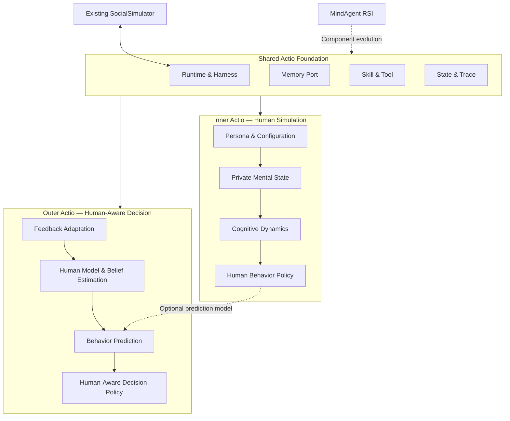
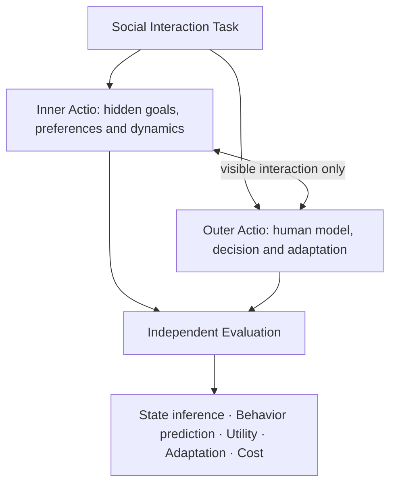

# Actio：2025–2026 Agent 系统与开源项目深度 Survey

> **主题**：面向人类行为仿真的 Inner Actio 与面向人类理解、预测及决策的 Outer Actio  
> **整理日期**：2026-11-16  
> **范围**：以 2025–2026 年的 Agent 系统、论文和开源工程为主；少量 2024 年的重要开源系统作为架构参照。  
> **用途**：Actio 框架设计、开源系统选型、学生分工与后续实验规划。

> **说明**：本文是对上一轮对话中完整 Survey 的 Markdown 整理与格式化，保留原有分析、项目判断和引用链接；本次导出**未额外重新核实**所有项目的实时维护状态、开源范围和论文元数据。文中“优点、局限、适用范围”主要是架构选型判断，除明确注明外，不是统一实验得出的性能排名。建议实际复现前以 GitHub 最新 README、Release 和论文正文为准。

---

## 执行摘要

本轮研究围绕两个功能不同但可以共享底层计算基础的 Actio 方向：

1. **Inner Actio — Human Simulation**：构建、组合与校准具有个体差异、内部状态和动态行为的模拟人。
2. **Outer Actio — Human-Aware Decision**：通过交互理解人的偏好、信念、意图和行为，并利用这些估计优化 AI 的行动。
3. **Actio Foundation**：共享状态、记忆、技能、工具、执行和轨迹接口，不再建设另一套社会模拟平台。

必须区分四类研究对象：**可运行的 Agent 框架、社会仿真平台、个体建模算法、Benchmark**。这些项目即使都研究 Human Simulation，也不能直接在同一软件层次替换。

本轮核心建议：

- **Foundation** 优先研究 Shachi（2025）的 Configuration–Memory–Tools–LLM 分解，以及 Actio 与环境交互的标准协议。
- **Inner** 优先研究 TinyTroupe（2025）的人物配置与实证校准、AgentSociety 2（2026）的模块化 Agent 与实验运行。
- **Outer** 优先研究 ToM-SWE（2026）的独立 Human Modeler、PAHF（2026）的澄清—行动—反馈循环，并以 PersonaMem 等独立测试集评价长期个体建模。
- 不推荐直接将某一个开源项目整体作为 Actio 的代码底座，而是复用可验证的接口、状态表示和实验设计。
- Inner 与 Outer 的共享重点应是**状态词汇、模型/技能调用接口、观察—行动协议和可追溯反馈**，而不是将模拟人的真实私有状态与 Outer 对人的估计混用。

---

# 一、近期文献中的架构变化

## 1.1 五项最值得关注的工作

| 论文 / 系统 | 年份 | 对 Actio 的主要启发 |
|---|---:|---|
| **Shachi** | 2025 | 用 Configuration、Memory、Tools、LLM 分解 Agent，通过受控消融研究组件作用。 |
| **TinyTroupe** | 2025 | 用 Persona、人物执行环境、干预和验证组织个体模拟。 |
| **AgentSociety 2** | 2026 | 将模块化人物 Agent、实验运行、环境、回放与研究工作流分离。 |
| **PersonaAgent** | 2026 | 人物画像不仅改变回复风格，还要连接到实际 Agent Action。 |
| **PAHF** | 2026 | 行动前澄清、行动后接收反馈、持续更新个体偏好。 |

这五项代表可组合认知架构、人物模拟、通用社会模拟、个性化决策和反馈驱动的长期适应。

## 1.2 两篇推荐的 Survey

1. **From Individual to Society: A Survey on Social Simulation Driven by LLM-based Agents**，ACM Computing Surveys（2026）。重点参照 Individual、Scenario、Society Simulation 的不同层级。链接：https://doi.org/10.1145/3800683
2. **Toward Personalized LLM-Powered Agents: Foundations, Evaluation, and Future Directions**（2026）。重点参照 Profile Modeling、Memory、Planning、Action Execution 的组织。链接：https://arxiv.org/abs/2602.22680

**趋势判断**：近两年系统逐步从“Persona + LLM 对话”走向“可配置的人物状态与行为机制”，以及“用户模型实际影响决策和行动”。但工程系统的运行成功，不能替代真实人类心理机制的效度验证。

---

# 二、Inner Actio：面向人类仿真模拟的开源项目

## 2.1 第一类：个体级、模块化的模拟人框架

### 2.1.1 Shachi（2025）——Foundation 首选参考

- **论文**：*Reimagining Agent-based Modeling with Large Language Model Agents via Shachi*。
- **GitHub**：https://github.com/SakanaAI/shachi
- **论文**：https://arxiv.org/abs/2509.21862
- **系统定位**：可组合的 LLM Agent-based Modeling 框架。

**主要机制**：将 Agent 分解为 **LLM、Configuration、Memory、Tools** 四个核心部分，并通过 Gym-style 环境接口进行交互。尤其重要的是明确区分：

- `Tool Call`：Agent 一次内部思考中的工具调用，可以不推进环境时间。
- `Action`：提交给环境并可能推进世界状态的行为。

论文还通过多类型任务分析 Agent 组件配置对行为的影响。

**优点**：模块边界清晰；组件可替换；Agent—Environment 协议简洁；适合做消融和最小运行时测试。

**不足**：更偏可控 Agent-based Modeling 的计算框架；并不天然提供完整的情绪、动机、社会关系与心理发展机制。

**对 Actio 的可复用价值**：直接学习 Agent/Environment 协议、Memory/Tools/Config 接口及 Tool–Action 的时间语义，作为 Foundation 最主要参照。

### 2.1.2 TinyTroupe（2025）——Persona 与模拟校准首选参考

- **论文**：*TinyTroupe: An LLM-powered Multiagent Persona Simulation Toolkit*。
- **GitHub**：https://github.com/microsoft/TinyTroupe
- **论文**：https://arxiv.org/abs/2507.09788
- **系统定位**：基于详细 Persona 的个体和群体模拟实验工具。

**主要机制**：以 `TinyPerson`、`TinyWorld` 为主要抽象，支持 Persona、Persona Fragments、环境干预、行为检查、模拟实验与实证对照。后续版本还扩展了基于调查数据的统计验证工具。

**优点**：人物配置和组合较成熟；容易快速构建不同个体；实验与干预操作明确；特别适合研究 Persona Schema 与 Simulation Validation。

**不足**：核心仍是人物行为模拟和研究探索，并非完整的心理机制模型；复杂 Persona 不等于更高的行为拟真性；不能将模拟输出直接当成现实决策依据。

**适用范围**：人物配置、可组合 Persona、行为检查、干预实验及 Empirical Validation。

### 2.1.3 AgentSociety 2（2026）——人物 Agent 扩展与实验运行参考

- **论文**：*AgentSociety 2: An Integrated Research Environment for Executable Social Science*。
- **GitHub**：https://github.com/tsinghua-fib-lab/AgentSociety
- **开发文档**：https://agentsociety2.readthedocs.io/en/latest/
- **系统定位**：可执行社会科学与模块化 LLM 社会模拟平台。

**主要机制**：LLM-native Agent、可注册的 Agent / Environment 模块、Research Skills、可回放执行及统一实验工作区；在职责上区分研究设计的 AI Social Scientist 与产生模拟行为的 Silicon Participants。

**优点**：自定义模块、实验运行、记录与扩展机制比较完整；适合学习 Agent 模块和环境模块如何独立注册与运行。

**不足**：系统涵盖大量社会模拟与研究编排职责；整体迁入 Rise 容易与现有 SocialSimulator、ControlPlane、MindAgent 重复。

**适用范围**：重点学习 PersonAgent、自定义 Cognition Module、Runtime Extension、实验回放；不推荐整体照搬。

### 2.1.4 三者互补关系

| Actio 设计问题 | 优先研究项目 |
|---|---|
| 单 Agent 如何模块化？ | Shachi |
| Persona 如何配置、组合和验证？ | TinyTroupe |
| Agent 组件如何注册、执行和恢复？ | AgentSociety 2 |
| 如何区分人物状态与世界状态？ | Shachi + AgentSociety 2 |
| 如何进行个体差异和行为分布校准？ | TinyTroupe |

**结论**：对当前 Actio 人力，优先精读上述三个核心仓库的关键代码，而不是复现所有社会仿真系统。

## 2.2 第二类：社会仿真平台与群体模拟框架

| 项目 | 年份 | GitHub | 主要优点 | 局限 / 对 Actio 适用范围 |
|---|---:|---|---|---|
| **YuLan-OneSim** | 2025 | https://github.com/RUC-GSAI/YuLan-OneSim | 自然语言场景构建、多领域模拟、规模化设计 | 主要参考 Scenario Generator；不是单个 Agent 认知组件的最佳底座。 |
| **GenSim** | 2025 | https://github.com/TangJiakai/GenSim | 通用社会情境抽象、规模化执行与错误纠正 | 对特定 AgentScope 分支和外部服务有依赖，适合研究实验恢复机制而非替换 Actio。 |
| **SocioVerse** | 2025 | https://github.com/FudanDISC/SocioVerse | 真实人群信息、个体行为及社会结果的校准思路 | 所引用仓库标注核心世界模型代码尚待发布，不宜视为完整可复现模拟器；适合 Population Fidelity 研究。 |
| **MiroFish** | 2026 | https://github.com/666ghj/MiroFish | 从事件材料组织人物、环境和模拟过程；工作流直观 | 依赖 OASIS，许可为 AGPL-3.0；预测系统的运行不代表预测效度；适合参考流程组织和展示。 |

**这些平台的共性**：主要解决“大量人物如何在共享世界中运行”，而不是单个个体的心智机制。Actio 应提取环境适配、状态可见性、场景配置、事件反馈及实验协议，不重建大型 Simulator。

## 2.3 第三类：具体认知过程的模拟工作

### CogTutor（2026）：模拟学习者的知识与典型错误

- **GitHub**：https://github.com/qi-github-ui/CogTutor
- **系统定位**：基于学习轨迹、知识依赖和错误模式的模拟学习者。

**主要价值**：从真实教学轨迹和知识依赖构造模拟学习者，体现能力水平、知识缺口及典型错误；不仅模拟人物话语风格，也模拟任务能力与错误模式。

**优点**：提供了一种按领域验证个体真实性的具体路径，适合模拟学生与训练 Tutor。

**不足**：领域较窄；工程代码更偏数据准备、知识组件和评价，模型微调依赖外部框架；不是通用人物 Runtime。

**适用范围**：Inner Actio 可借鉴“知识、能力、典型错误”作为 Persona 或 Mental State 的可组合维度，并用真实学习轨迹进行领域校准。

## 2.4 2024 年保留的两个开源工程参照

| 系统 | GitHub | 借鉴点 | 当前优先级 |
|---|---|---|---|
| **Concordia** | https://github.com/google-deepmind/concordia | Entity–Component、Game Master、人物状态与世界裁决的分离 | 辅助参考，可组合 Cognitive Components |
| **OASIS** | https://github.com/camel-ai/oasis | 大规模社交平台互动、消息传播和网络行为模拟 | 较低；当前不应重建大型分布式社会平台 |

当前只需要 10–100 人的最小可用场景，因此单人认知状态和可配置行为能力优先级高于大规模社会分布式执行。

---

# 三、Outer Actio：面向人类分析、预测与决策的系统

Outer 的关键不是生成一个“像人”的角色，而是使 AI 通过交互建立对人的状态估计，并用这些估计改善实际决策。

## 3.1 第一类：显式用户建模与 Theory of Mind Agent

### 3.1.1 ToM-SWE（ICML 2026）：独立 Human Modeler

- **GitHub**：https://github.com/OpenHands/ToM-SWE
- **论文**：https://proceedings.mlr.press/v306/zhou26f.html
- **定位**：将用户心智理解作为软件工程 Agent 的独立 Partner Agent。

**核心机制**：把主任务 Agent 和专门的 ToM Partner Agent 分离。后者通过用户指令、对话历史和行为线索推断用户目标、偏好和约束，并将人物模型提供给主 Agent。公开项目采用对话记录、会话分析、用户画像的分层结构，并有 OpenHands 集成。

**优点**：Human Modeling 与任务执行解耦，便于测试“用户模型是否真正改善任务结果”；论文包含 Stateful SWE 任务和真实开发者使用研究。

**不足**：重点是软件工程协作；人物状态字段与评价有明显领域依赖；独立 ToM Agent 增加推理成本。

**适用范围**：Outer 的 `HumanModeler → TaskAgent` 接口，尤其适合独立维护人物状态、证据及上下文。

### 3.1.2 UserHarness（EMNLP 2026）：显式心智状态重建

- **论文**：https://aclanthology.org/2026.findings-emnlp.560/
- **定位**：从用户观察、信念、意图与行动关系重建心理状态。

**优点**：对 `Observation → Belief → Intention → Action` 的数据字段和推断过程有直接参考价值；提供多个 ToM Benchmark 的测试。

**不足**：研究主要支持 ToM 推断准确性，不能直接推出真实长周期决策效用；本轮调研未确认完整官方工程仓库。

**适用范围**：Outer Human State Model 和状态估计方法，不作为即装即用的框架。

### 3.1.3 Eva（2025）：神经符号协作对话与 Planning

- **论文**：https://link.springer.com/article/10.1007/s10458-025-09717-5
- **定位**：显式 Beliefs、Goals、Intentions 的协作对话系统。

**核心机制**：将提问、确认、建议等对话行为描述为影响状态的动作，使用规划与 ToM 组织协作。

**优点**：状态定义、决策依据及行动语义比较清晰，为 Outer Goal、Action 和 Decision Record 提供形式化参照。

**不足**：神经符号式规划较复杂，不适合 V1 全面复现；本轮未确认可复用的官方代码发行版。

**适用范围**：Outer 的 `Human State + Task Goal + Action Effect` 设计。

## 3.2 第二类：个性化决策与长期偏好适应

### 3.2.1 PAHF（2026）：第一个建议复现的 Outer 项目

- **GitHub**：https://github.com/facebookresearch/PAHF
- **论文**：https://arxiv.org/abs/2602.16173
- **定位**：从人类反馈中学习个性化 Agent。

**核心闭环**：

```text
Pre-action Clarification → Action Execution → Post-action Feedback
          ↑                                      │
          └──────── Preference Update ───────────┘
```

**实现元素**：`BasePersonalAgent`、具身及购物任务、基于 Persona 的反馈机制、阶段式训练和评测协议。

**优点**：环路简洁，容易做算法与组件消融；特别适合研究偏好变化、主动澄清和行动后适应；有可执行代码与配套任务。

**不足**：公开人物反馈机制主要依据预定义 Persona，尚不足以视为复杂真实的人类心理模型；模拟有效性与真人泛化需要分开验证。

**适用范围**：Outer 的动态用户适应与反馈更新，适合作为首个复现实验。

### 3.2.2 PersonaAgent（Findings of ACL 2026）：画像进入行动策略

- **论文**：https://aclanthology.org/2026.findings-acl.1315/
- **定位**：利用个性化 Episodic / Semantic Memory 构建动态 Persona，并指导 Agent Action。

**优点**：从“文本风格个性化”推进到“工具选择和任务行动个性化”；长期交互记录进入决策策略。

**不足**：Persona 仍在较大程度上以 User-specific System Prompt 表达，不完全等于可检查的信念/意图/不确定性状态；本轮未确认官方可运行 GitHub 项目。

**适用范围**：Outer 的 `Human Profile → Action Policy`。

### 3.2.3 DeepTutor（2026）：学习者画像与教学策略

- **GitHub**：https://github.com/HKUDS/DeepTutor
- **论文**：https://arxiv.org/abs/2604.26962
- **定位**：个性化教学 Agent 系统。

**主要机制**：长期学习者画像、问题生成、互动教学及个性化反馈；配合 TutorBench 评价。

**优点**：真实系统工程，展示了 Human Model 如何与教学策略、问题求解及交互反馈结合。

**不足**：教育专用、模块较多；不能直接成为通用人类分析决策框架。

**适用范围**：Outer 的认知引导与教学应用验证。

## 3.3 第三类：人机协作与主动交互

| 项目 | 论文 / 项目链接 | 核心问题 | 优点 | 局限与适用范围 |
|---|---|---|---|---|
| **CowCorpus / PlowPilot**（2026） | https://github.com/oaishi/PlowPilot | 人何时介入 Agent 执行、不同介入风格 | 基于真实人机交错操作轨迹；适合设计介入预测器 | Web Agent 任务专用，不可直接推广为所有心理状态；适合 Outer 的求助时机和共享控制。 |
| **EOPA**（2026） | https://arxiv.org/abs/2608.04416 | 主动 Agent 应何时交互、何时不打扰 | 研究在线偏好适应与交互时机 | 研究范围聚焦 Interaction Timing，本轮未确认完整官方工程仓库。 |
| **PersonalAgent**（2026） | https://github.com/Monncyann/PersonalAgent | 多轮画像、冷启动和持续个性化 | 长期用户特征及逐轮偏好调整 | 已核实的仓库主要公开数据与说明，不能按成熟 Runtime 评估。 |

**新研究方向提示**：Outer 不仅要估计“用户喜欢什么”，还要判断“用户什么时候希望 AI 帮忙、什么时候更倾向自主完成、什么时候应该主动提问”。这一方向能形成独立的 Human-Aware Decision 任务。

## 3.4 独立用户建模评价资源

| Benchmark / 数据 | 年份 | 公开链接 | 主要测量目标 |
|---|---:|---|---|
| **PersonaMem** | 2025 | https://github.com/bowen-upenn/PersonaMem | 多轮对话中显式/隐式用户特征推断 |
| **PersonaMem-v3** | 2026 | https://github.com/bowen-upenn/PersonaMem-v3 | 跨平台用户理解、推荐和 Agent 任务；部分脱敏真实数据 |
| **RealPref** | 2026 | https://github.com/GG14127/RealPref | 长期隐式偏好、长上下文及跨场景偏好遵循 |
| **TutorGym** | 2025 | https://tutorgym.ai/ | Tutor–Student 分步交互、教学策略与提示评价 |

**三种能力应分别评估**：

1. `Human Modeling Accuracy`：是否推断对了人的状态或偏好？
2. `Preference Following / Prediction`：是否在未见任务中正确使用偏好？
3. `Human-Aware Decision Quality`：是否真正改善用户相关任务的行动与结果？

不能只用最终任务成功率掩盖用户模型的错误，也不能只提高画像准确率而忽略决策效果。

---

# 四、跨项目横向比较：优缺点与适用范围

以下为基于公开功能进行的**定性架构评估**，不是统一性能排名。

| 项目 | 最强的设计点 | 最主要的不足 | 对 Actio 的推荐用途 |
|---|---|---|---|
| **Shachi** | Config / Memory / Tools / LLM 解耦 | 心理 Dynamics 不够丰富 | **Foundation 核心参照** |
| **TinyTroupe** | Persona、模拟实验、个体行为验证 | 心理机制相当程度由 LLM 隐式实现 | **Inner 人物配置与校准** |
| **AgentSociety 2** | 组件、执行、实验与回放 | 系统大，容易重复建设 | **Inner Runtime / Extension** |
| **YuLan-OneSim** | 场景生成与多领域模拟 | 不专注单 Agent 心智组件 | 外部 Scenario Adapter |
| **GenSim** | 规模化与实验纠错 | 部署依赖较多 | 实验纠错与恢复机制 |
| **SocioVerse** | 真实人口信息与社会行为校准 | 核心模型开源不完整 | Population Fidelity |
| **CogTutor** | 真实学习轨迹下的知识和错误模拟 | 领域窄、无通用 Runtime | Inner 认知能力建模 |
| **ToM-SWE** | 独立用户心智建模模块 | 软件工程领域依赖 | **Outer Human Modeler** |
| **UserHarness** | 显式 Observation / Belief / Intention | 主要测 ToM，代码完整性待核实 | Outer 状态建模方法 |
| **PAHF** | 行动前澄清与行动后反馈 | 人物反馈设定相对简化 | **Outer 动态适应机制** |
| **PersonaAgent** | Profile → Tool Action | 显式心理状态较弱 | Outer 决策策略 |
| **DeepTutor** | 学习者建模与教学适应 | 教育专用、系统较大 | Outer 认知引导 |
| **CowCorpus / PlowPilot** | 真实协作介入轨迹 | Web 任务专用 | Outer 主动协作 / 求助时机 |

## 4.1 最推荐精读的六个对象

| 设计层 | 项目 | 精读内容 | 仓库 |
|---|---|---|---|
| Foundation | Shachi | Agent/Environment 协议、工具和行动区分、组件消融 | https://github.com/SakanaAI/shachi |
| Inner Persona | TinyTroupe | Persona 结构、干预、经验校准 | https://github.com/microsoft/TinyTroupe |
| Inner Runtime | AgentSociety 2 | PersonAgent、模块注册、恢复与回放 | https://github.com/tsinghua-fib-lab/AgentSociety |
| Outer Modeling | ToM-SWE | 独立 Human Modeler 与 Task Agent 连接 | https://github.com/OpenHands/ToM-SWE |
| Outer Adaptation | PAHF | 主动澄清、反馈与偏好漂移 | https://github.com/facebookresearch/PAHF |
| Outer Evaluation | PersonaMem | 长期画像与隐含偏好评价 | https://github.com/bowen-upenn/PersonaMem |

**选型结论**：不选择其中一套软件作为全部 Actio 底座。Shachi 长于组件接口，TinyTroupe 长于人物模拟，ToM-SWE/PAHF 长于用户理解与人相关决策，适宜吸收架构与测试方法，不宜将完整框架粗暴拼接。

---

# 五、Actio 架构修订：Foundation / Inner / Outer

建议继续采用三层架构，但严格区分：

- `Cognitive Configuration`：相对稳定的人物设定和个体差异。
- `Dynamic State`：随事件变化的信念、目标、意图、情绪与关系。
- `Human Model`：Outer 对某个人的估计及其不确定性。
- `Rationale`：可追溯的决策依据或解释记录，而非与 Persona / Memory 并列的基础心理能力。

## 5.1 总体结构



> 图中为职责与接口关系，并不要求每个组件分别部署或分别调用一次大模型。

## 5.2 Foundation：五项职责

| Foundation 模块 | 内容 | 主要参考 |
|---|---|---|
| **Agent Runtime** | 实例化、Step、Episode 生命周期、状态、恢复 | Shachi、AgentSociety 2 |
| **Harness** | 模型调用、工具执行、上下文组织、预算 | Shachi |
| **Memory / Experience** | 交互历史、过程经验与存储端口 | 现有 SimpleActio |
| **Skill / Tool** | 可选择的认知能力、行动能力及工具使用 | SimpleActio、Shachi |
| **State & Trace** | 当前状态、行动事件、版本和状态变化记录 | AgentSociety 2、RISE |

**边界原则**：Skill、Memory、Harness 属于执行基础；Persona、Belief、Emotion 等属于上层 Cognition。Memory 不重新建设存储库，继续对接现有端口。

## 5.3 Inner：五个主模块

| 主模块 | 主要内容 | 主要参考 | V1 |
|---|---|---|---|
| Persona / Configuration | 人格、身份、个体特征、能力参数 | TinyTroupe、Shachi | 必做 |
| Mental State | Belief、Goal、Intention、Preference | Shachi、AgentSociety 2 | 必做 |
| Cognitive Dynamics | 事件驱动的信念、目标、情绪及关系更新 | AgentSociety 2 等 | 简化版 |
| Behavior Policy | 根据当前状态生成/选择行为 | Shachi、TinyTroupe | 必做 |
| Behavioral Calibration | 与人物设定、实验假设及参照数据比较 | TinyTroupe、CogTutor | 简化版 |

Affect、Motivation、Relationship 可作为 Mental State 和 Dynamics 下的可插拔子模块，不必第一阶段全都独立创建复杂服务。

**核心强调**：心理学概念的数量不应直接决定工程模块的数量。

## 5.4 Outer：五个主模块

| 主模块 | 内容 | 主要参考 |
|---|---|---|
| **Human Profile** | 稳定个体信息、历史偏好和长期目标 | PersonaMem、PersonaAgent |
| **Human State Estimator** | 当前信念、意图、需求及不确定性 | ToM-SWE、UserHarness |
| **Human Behavior Predictor** | 不同情境/AI 行动下的人类反应预测 | ToM-SWE、PAHF |
| **Human-Aware Policy** | 结合人物模型、当前任务选择 AI 行动 | PAHF、PersonaAgent |
| **Interaction Feedback** | 行动前澄清、行动后修正、偏好变化适应 | PAHF、CowCorpus |

Outer 的创新重点是：**Human Model 是可以被 Policy 读取的结构化估计，不只是用户描述文本。**

```python
from dataclasses import dataclass

@dataclass
class HumanModel:
    person_id: str
    stable_preferences: dict
    current_goal_hypotheses: dict
    belief_hypotheses: dict
    confidence: dict
    evidence_refs: tuple[str, ...]
    last_updated: str

class HumanAwarePolicy:
    def decide(self, human_model, task_context, available_actions):
        """Returns an ActionProposal; proposed interface, not current RISE API."""
        ...
```

必须区分事实、假设、置信度和证据来源。Outer 只能读取正常交互可观察的信息，不能直接获取 Inner 模拟人物的私有真值。

---

# 六、三个值得研究的 Gap

## Gap 1：Human Simulation 与 Human Understanding 仍相对割裂

**科学问题**：能否使用共享的心智状态表示，支持人的正向行为模拟与 AI 对人的反向状态推断？

- Inner：在给定个人状态下生成行动。
- Outer：从观察到的行动估计人的状态。
- 共享 Belief / Goal 概念结构，但严格隔离真实状态与估计状态。

**建议实验**：模拟人物隐藏目标、偏好发生变化；Outer 对未见人物进行推断，比较静态用户模型与动态更新模型的行为预测和决策收益。

## Gap 2：Persona 配置与真实行为拟真之间仍有距离

**科学问题**：Personality、Knowledge、Goals、Dynamics 哪些因素真正带来稳定可预测的个体行为差异？

**建议实验**：分别启用 Persona、Mental State、Dynamics，控制模型与算力预算，比较：

- 行为分布与个体一致性；
- 角色行为随情境变化的合理性；
- 对未见情境的行为泛化；
- 在领域有数据时与真实人的行为分布比较。

不要仅用不同 Persona 产生了不同的话术来证明人类行为拟真性。

## Gap 3：Human Modeling Accuracy 不等于 Decision Utility

**科学问题**：何时启动 Human Model，何时直接行动，何时主动向人澄清？

**建议 Baselines**：

1. Direct Agent：无显式用户模型。
2. Static Profile：静态用户画像。
3. Dynamic Human Model：随互动更新用户模型。
4. Simulation-Assisted Decision：使用 Inner 的预测辅助决策。

**建议指标**：Human-State Accuracy、Behavior Prediction、Task Utility、Adaptation Latency、Model Calls、Tokens 和成本。

---

# 七、团队执行建议

## 7.1 三名 Actio 同学的主要研究任务

| 方向 | 优先精读 / 复现 | 提取的组件 | 首个实验 |
|---|---|---|---|
| **Actio Foundation** | Shachi + AgentSociety 2 | Agent Step、Configuration、State、Skill/Tool、Trace | Inner / Outer 共用 Runtime |
| **Inner Actio** | TinyTroupe + Shachi；补充 CogTutor | Persona、Mental State、Dynamics、Behavior Policy | Hidden Belief / Preference Drift |
| **Outer Actio** | ToM-SWE + PAHF；补充 UserHarness | Human Model、State Estimator、Decision Policy、Feedback | 动态偏好推断与面向人决策 |

## 7.2 第一轮只复现四种最小能力

| 最小任务 | 参照 | 验收 |
|---|---|---|
| Modular Agent | Shachi | 替换 Config、Memory、Policy 不影响环境接口 |
| Persona-conditioned Simulation | TinyTroupe | 个体配置差异产生稳定、可测的行为差异 |
| Explicit Human Modeling | ToM-SWE / UserHarness | 能从观察推断目标、区分错误判断和不确定状态 |
| Feedback-driven Adaptation | PAHF | 人物偏好变化后能根据反馈修正行动策略 |

## 7.3 Inner–Outer 联合实验



**运行约束**：SocialSimulator 保存隐藏人物状态及环境结果；Outer 仅获得正常交互中可见的信息。评估工具可以读取真值，但不把真值泄漏给待测 Agent。

---

# 八、最终技术选型及阅读优先级

| Actio 层次 | 首要参照 | 采用其什么思想 |
|---|---|---|
| **Foundation** | **Shachi（2025）** | Configuration + Memory + Tools + LLM，以及 Agent/Environment 协议 |
| **Inner Architecture** | **TinyTroupe（2025）、AgentSociety 2（2026）** | 人物配置、模块化执行、行为实验、回放 |
| **Inner Validation** | **TinyTroupe、CogTutor（2026）** | 使用真实或受控的行为参照校准模拟结果 |
| **Outer Human Modeling** | **ToM-SWE（2026）、UserHarness（2026）** | 显式用户信念、意图、目标估计 |
| **Outer Decision & Adaptation** | **PAHF（2026）、PersonaAgent（2026）** | 人物模型进入行动选择，交互反馈持续适应 |
| **Outer Evaluation** | **PersonaMem、RealPref（2025–2026）** | 长期画像、偏好漂移和跨任务评价 |

如果阅读时间进一步收紧：

1. **Shachi**：Actio 最基本的模块边界。
2. **ToM-SWE**：面向人的心智理解如何成为独立组件。
3. **PAHF**：人物模型如何通过交互反馈改进 Agent 决策。
4. **TinyTroupe**：Persona、模拟实验及数据校准。
5. **AgentSociety 2**：可扩展的人物模块与社会模拟运行方式。

**最终定位**：

- **Inner Actio**：通过不同心理和认知配置生成可验证的个体行为差异。
- **Outer Actio**：显式估计人的状态，并依据反馈持续改善自身行动。
- **Foundation**：让两者共享可组合、可执行、可观察的 Agent 运行基础。

---

# 九、项目与参考文献链接索引

> 注：以下优先沿用上一轮调研已有链接。未确认官方仓库的工作只列论文，不虚构 GitHub 地址。

## 9.1 Inner Actio / 模拟人 / 社会仿真

| 名称 | 论文 / 文档 | GitHub |
|---|---|---|
| Shachi | https://arxiv.org/abs/2509.21862 | https://github.com/SakanaAI/shachi |
| TinyTroupe | https://arxiv.org/abs/2507.09788 | https://github.com/microsoft/TinyTroupe |
| AgentSociety 2 | https://agentsociety2.readthedocs.io/en/latest/ | https://github.com/tsinghua-fib-lab/AgentSociety |
| YuLan-OneSim | — | https://github.com/RUC-GSAI/YuLan-OneSim |
| GenSim | — | https://github.com/TangJiakai/GenSim |
| SocioVerse | — | https://github.com/FudanDISC/SocioVerse |
| MiroFish | — | https://github.com/666ghj/MiroFish |
| CogTutor | — | https://github.com/qi-github-ui/CogTutor |
| Concordia（较早参照） | — | https://github.com/google-deepmind/concordia |
| OASIS（较早参照） | — | https://github.com/camel-ai/oasis |

## 9.2 Outer Actio / 用户理解 / 决策与反馈

| 名称 | 论文 / 文档 | GitHub |
|---|---|---|
| ToM-SWE | https://proceedings.mlr.press/v306/zhou26f.html | https://github.com/OpenHands/ToM-SWE |
| UserHarness | https://aclanthology.org/2026.findings-emnlp.560/ | 未确认 |
| Eva | https://link.springer.com/article/10.1007/s10458-025-09717-5 | 未确认 |
| PAHF | https://arxiv.org/abs/2602.16173 | https://github.com/facebookresearch/PAHF |
| PersonaAgent | https://aclanthology.org/2026.findings-acl.1315/ | 未确认 |
| DeepTutor | https://arxiv.org/abs/2604.26962 | https://github.com/HKUDS/DeepTutor |
| CowCorpus / PlowPilot | — | https://github.com/oaishi/PlowPilot |
| EOPA | https://arxiv.org/abs/2608.04416 | 未确认 |
| PersonalAgent | — | https://github.com/Monncyann/PersonalAgent |
| PersonaMem | — | https://github.com/bowen-upenn/PersonaMem |
| PersonaMem-v3 | — | https://github.com/bowen-upenn/PersonaMem-v3 |
| RealPref | — | https://github.com/GG14127/RealPref |
| TutorGym | https://tutorgym.ai/ | 未列出 |

## 9.3 总览文献

1. *From Individual to Society: A Survey on Social Simulation Driven by LLM-based Agents*，ACM CSUR，2026：https://doi.org/10.1145/3800683
2. *Toward Personalized LLM-Powered Agents: Foundations, Evaluation, and Future Directions*，2026：https://arxiv.org/abs/2602.22680

---

# 十、后续执行反馈模板

建议复现与阅读时按以下结构记录，以便下一轮决定 Actio 的最终接口与团队实现优先级。

```markdown
## 项目：<Shachi / TinyTroupe / ToM-SWE / PAHF / ...>

### 1. 复现信息
- Commit / Release:
- 运行环境:
- 是否完整跑通:
- 实际使用的模型与成本:

### 2. 组件结构
- Agent Interface:
- State Schema:
- Persona / Human Model:
- Memory / Skill / Tool:
- Policy / Dynamics:
- Trace / Snapshot:

### 3. 已验证的行为
- 原论文中的结果:
- 我们实际得到的结果:
- 哪些指标来自模拟真值，哪些来自真实人的数据:

### 4. 对 Actio 的复用建议
- 可直接复用的代码或协议:
- 只能借鉴思想的部分:
- 与 RISE SimpleActio 的冲突:
- 最小适配工作量:

### 5. 风险与下一步
- 数据或评测限制:
- 运行或依赖问题:
- 希望下一轮讨论的架构决策:
```

