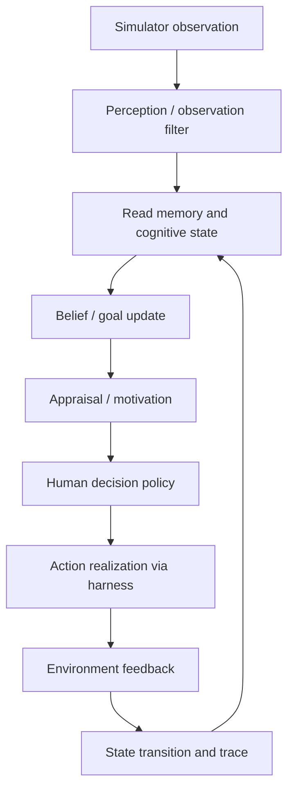

# Actio 社会心智智能体框架：跨学科文献调研、三层架构与落地规划

> **文档版本**：V1.0 · 2026-11-16  
> **用途**：Actio 架构设计、团队研讨、工程任务拆解、文献精读及后续实验执行。  
> **研究场景**：RISE（Recursive Interactive Social mind Evolution）中的社会心智基础智能体。  
> **范围**：基础 Agent Harness/Runtime/Memory/Skill、模拟人的 Inner Actio、面向人的决策 Outer Actio、接口、RISE 集成、实验与评估。  
> **说明**：本文整理上一轮完整分析。文献提供设计依据及可检验的研究假设；具体模块划分是**面向 Actio 的工程研究建议**，并不声称是心理学公认的唯一架构。引用的网址提供追踪入口，正式论文写作和工程复现前需逐条核查文献版本、开源许可与适用条件。

---

# 执行摘要

## Actio 的基本定位

Actio 应作为**面向人类社会认知与决策的可组合智能体架构（Composable Social-Cognitive Agent Architecture）**，而不只是 Persona Prompt + Memory 的包装器。

其两个相互关联但目标不同的任务为：

1. **Human Simulation / Inner Actio**：构建具有个体差异、内部状态、目标动机及行为动态的虚拟人，研究“人在给定信息、情境与经历条件下会如何理解、判断、行动”。
2. **Human-Aware Decision-Making / Outer Actio**：构建能够从人的行为与交互历史中推断人的隐含状态、需求与目标，并据此改善 AI 自身决策的智能体。

二者共享基础执行协议和部分认知模块，但不应共享未经区分的主观状态：

- **Inner** 的状态可以是模拟世界中定义的角色私有状态；
- **Outer** 的人物状态是 AI 对人的**估计/假设**，必须保留来源、不确定性与更新信息。

## 最重要的架构结论

```text
                         Actio Social-Cognitive Agent System

            ┌────────────────────────────┬────────────────────────────┐
            │        Inner Actio         │        Outer Actio         │
            │      Human Simulation      │    Human-Aware Decision    │
            │                            │                            │
            │ Persona, Beliefs & Goals   │ Human Profile & Context    │
            │ Motivation & Emotion       │ Mental-State Estimation    │
            │ Relationship & Dynamics    │ Behavior Prediction        │
            │ Human Decision Policy      │ Human-Aware Decision       │
            │ Behavior Generation        │ Feedback Adaptation        │
            └──────────────┬─────────────┴──────────────┬─────────────┘
                           │ shared cognitive interfaces│
            ┌──────────────┴────────────────────────────┴─────────────┐
            │                   Actio Foundation                      │
            │  Harness | Runtime | Cognitive State | Observation     │
            │  Memory Port | Skill & Tool | Action | Trace           │
            └──────────────────────────────┬─────────────────────────┘
                                           │
                SocialSimulator     Model Backends      MindAgent RSI
```

应最先确定 **`CognitiveState`、`CognitiveDynamics`、`DecisionPolicy`、`ActioAgent.step()`** 四种核心抽象，完成 Inner 和 Outer 各一个最小实验，再逐步引入复杂心理机制。

---

# 第一部分：跨学科文献调研

# 1. 五项关键发现

## 1.1 认知架构需要显式状态、目标、记忆、决策和学习

经典认知架构 ACT-R、Soar 与 BDI 的共同启示是：智能体不是单纯给基础模型增加提示，而需要组织其状态、知识、目标和行动过程。Actio 应借鉴这些架构的**职责分离**，但不需要完整实现某一种架构。

**建议**：将 `CognitiveState`、`DecisionPolicy` 与 `CognitiveDynamics` 明确分开，并允许这些模块采用规则、概率模型、优化器或 LLM 实现。

## 1.2 稳定人格与变化的心理状态需要分离

五因素人格模型支持对较稳定的个体差异进行刻画；Mischel–Shoda 的认知—情感人格系统（CAPS）强调人具有**情境条件化的行为特征**，而不是对所有情况都给出固定行为。

**建议**：`Persona` 主要定义较稳定的个体参数；当前信念、目标、情绪、关系与计划另行储存；`Dynamics` 按观察、行动和事件更新这些状态。

## 1.3 Memory、Reflection、Planning 能改善长程行为连续性

Generative Agents 将记忆、反思与规划组合起来，提供 LLM 社会模拟的重要工程范式。后续 Humanoid Agents 通过需求、情绪和关系等机制扩充了这种表示。

**建议**：长期记忆只是状态信息来源之一；应把**工作状态（working state）**与**长期经验（memory）**区分，并引入可检查的状态更新过程。

## 1.4 Inner 与 Outer 可通过正向行为模型 / 逆向心智推断连接

Bayesian Inverse Planning 及 I-POMDP 将观察到的行为与其背后的目标、信念联系起来，并将他人模型用于智能体自己的决策。

- Inner：根据人物内部状态产生行为（forward generation）。
- Outer：根据可观测行为推断人的状态，并决定 AI 自身行动（inverse inference + decision）。

**建议**：Outer 可选用 Inner 作为反事实人物模型，但不能将 Inner 的隐藏真值泄漏给 Outer，也不能把其预测视为真实人的必然反应。

## 1.5 行为逼真并不代表具有人类认知机制

LLM 人物模拟有可能在某些语料/问卷上表现得像人，同时仍不具备准确的跨情境行为动态或可验证的心理机制。因此必须分层评估：

1. 模拟器机制和状态转移是否按定义正确执行；
2. 人物行为是否与已知角色条件相符；
3. 行为分布是否能够独立匹配真实人类数据；
4. 显式心理模块是否真的带来可重复的增益。

---

# 2. 经典认知架构与社会决策理论

| 代表工作 | 主要思想 | Actio 的可借鉴内容 | 不宜直接照搬 |
|---|---|---|---|
| **ACT-R**（Anderson 等） | 认知模块、缓冲区、知识和产生式规则 | 认知处理模块、工作记忆与目标的结构化分离 | 无需复现全套 ACT-R |
| **Soar**（Laird 等） | 工作记忆、算子选择、学习与行动 | 可检查的认知—行为循环 | 不必把全部 LLM 行为转化为符号规则 |
| **BDI**（Rao & Georgeff） | Beliefs、Desires、Intentions | Actio 的信念—目标—意图架构 | BDI 并非完整人类心理模型 |
| **Bayesian Inverse Planning**（Baker et al.） | 根据观察行为推断他人信念与目标 | Outer 人物状态估计 | 大规模精确逆规划开销高 |

## 理论到接口的映射

```text
Beliefs      -> CognitiveState.beliefs
Goals        -> CognitiveState.goals
Intentions   -> CognitiveState.intentions
Decision     -> DecisionPolicy.decide()
Learning     -> CognitiveDynamics.update() / independent evolution
Working State-> Runtime StateStore
```

**设计原则**：Actio 应有一个理论相对中立的共享 Foundation，BDI 可作为初始实现的建模思路之一，而不是强制所有认知模型服从单一心理学范式。

### 参考文献

- ACT-R 相关综述：[doi:10.1002/wcs.1488](https://doi.org/10.1002/wcs.1488)
- 认知架构综述：[doi:10.1007/s10462-020-09901-x](https://doi.org/10.1007/s10462-020-09901-x)
- BDI Agent Architectures: A Survey（IJCAI 2020）：[IJCAI](https://www.ijcai.org/proceedings/2020/0684.pdf)
- Baker et al., *Action Understanding as Inverse Planning*（Cognition, 2009）：[doi](https://doi.org/10.1016/j.cognition.2009.07.005)

---

# 3. 人格、动机、情绪和动态心理状态的理论依据

| 研究理论 | 研究对象 | 对应的 Actio 表示或机制 |
|---|---|---|
| Five-Factor Model（McCrae & John, 1992） | 个体相对稳定的人格特质 | `PersonaSpec.traits` |
| CAPS（Mischel & Shoda, 1995） | 人格与情境的条件化行为动态 | `Persona × Situation -> Decision/Dynamics` |
| Theory of Planned Behavior（Ajzen, 1991） | 态度、主观规范、知觉控制与行为意图 | `Goals / Intentions / Decision` 的条件化建模 |
| Appraisal / EMA（Marsella & Gratch, 2009） | 事件评价与情绪变化 | `AffectState` 与 `AppraisalDynamics` |
| Emotion Regulation（Gross, 1998） | 情绪反应调节 | 可插拔 `EmotionRegulationPolicy` |

## 三个时间尺度

建议根据工程需要明确三个状态时间尺度，不应误认成心理学文献公认的统一划分。

| 时间尺度 | 典型变量 | 更新方式 |
|---|---|---|
| 长期 | Traits、持久偏好、身份、长期目标 | 默认相对稳定，显式事件或校准后调整 |
| 中期 | 关系、信任、承诺、当前目标、计划 | 随重要事件及多轮反馈更新 |
| 短期 | 情绪、注意、即时意图、执行准备 | 每轮或按事件更新 |

例如一个谨慎的人在充分证据下可能作积极决策，在信息不足时可能延迟行动。这种情境条件化行为比“谨慎人格每轮说谨慎的话”更合理。

### 参考文献

- McCrae & John (1992), Five-Factor Model：[PubMed](https://pubmed.ncbi.nlm.nih.gov/1635039/)
- Mischel & Shoda (1995), CAPS：[PubMed](https://pubmed.ncbi.nlm.nih.gov/7740090/)
- Ajzen (1991), Theory of Planned Behavior：[doi](https://doi.org/10.1016/0749-5978(91)90020-T)
- Marsella & Gratch (2009), EMA：[doi](https://doi.org/10.1016/j.cogsys.2008.03.005)
- Gross (1998), Emotion Regulation：[doi](https://doi.org/10.1037/1089-2680.2.3.271)

---

# 4. LLM 社会模拟、虚拟人与通用组件体系

## 4.1 Generative Agents（Park et al., UIST 2023）

**核心结构**：Memory Stream、Reflection、Planning。它为社会模拟提供了连续记忆、反思总结和行动规划的典型实现。

**借鉴**：把具体发生的事件与长期概括分开，允许记忆与反思更新未来策略。不能因为有 Memory Stream 就认定具备心理学意义上的真实记忆机制。

- 论文：[Generative Agents: Interactive Simulacra of Human Behavior](https://arxiv.org/abs/2304.03442)
- 代码：[joonspk-research/generative_agents](https://github.com/joonspk-research/generative_agents)

## 4.2 Concordia（Google DeepMind）

**核心结构**：Entity–Component–Prefab 及环境驱动的交互组织。适合借鉴模块化认知组件与实体之间的装配机制。

**借鉴**：组件间通过明确输入输出协议连接；世界状态属于环境，主体只能看到自身观察。Actio 本身不需要复制完整模拟器。

- 项目：[google-deepmind/concordia](https://github.com/google-deepmind/concordia)
- 组件说明：[components/README.md](https://github.com/google-deepmind/concordia/blob/main/concordia/components/README.md)

## 4.3 Humanoid Agents（Wang et al., EMNLP 2023）

**核心结构**：在行为生成中引入需求、情绪、关系亲密度等因素。

**借鉴**：`Motivation`、`Affect`、`Relationship` 有理由作为独立或可替换的 Dynamics 组件，但各自的建模质量应分别验证。

- 论文：[EMNLP 2023 Demonstrations](https://aclanthology.org/2023.emnlp-demo.15/)

## 4.4 Generative Agent Simulations of 1,000 People

**核心问题**：依据个体访谈构建人物代理，并比较模拟输出与真实个人的问卷、实验结果。

**借鉴**：人物画像应支持行为证据，而不仅是简短随机 Persona。文献中“达到真人重测一致性约 85% 的相对水平”不是“每个模拟人物有 85% 绝对行为预测准确率”。

- 论文：[arXiv 2411.10109](https://arxiv.org/abs/2411.10109)

## 4.5 SOTOPIA / SOTOPIA-π

**核心问题**：多目标、开放式社会互动的能力评估，以及从互动轨迹与反馈中学习改善。

**借鉴**：Actio 认知组件不能只在静态问答中测；需要独立的交互式任务与行为结果评估。

- [SOTOPIA（ICLR 2024）](https://proceedings.iclr.cc/paper_files/paper/2024/hash/b3075b88e583a0e98d8b24338a613060-Abstract-Conference.html)
- [SOTOPIA-π（ACL 2024）](https://aclanthology.org/2024.acl-long.698/)

## 4.6 AgentSociety

**定位**：大规模社会仿真框架，可作为未来 100–1000 个 Agent 扩展时的参考。当前 Actio 团队不应先重建分布式模拟执行系统。

---

# 5. 面向人的建模与决策研究

| 代表工作 | 核心观点 | 对 Outer Actio 的作用 |
|---|---|---|
| Baker、Saxe、Tenenbaum（2009），Inverse Planning | 从行动推断目标与信念 | `HumanStateEstimator` |
| Gmytrasiewicz & Doshi（2005），I-POMDP | 将其他主体的模型引入决策状态 | `HumanModel` + `DecisionPolicy` |
| Hadfield-Menell et al.（2016），CIRL | AI 在未知人类目标下协作并逐步获取信息 | 人类目标不确定时的决策与交互 |
| Intelligent Tutoring Systems | Domain Model、Student Model、Tutoring Model、Interface | 区分学习者模型与帮助策略 |

**核心结论**：

```text
Inner:  state + persona + context -> simulated human behavior
Outer:  observed behavior -> inferred human state -> AI decision
```

二者可以共享建模组件，但 Inner 的模拟内部真值不得直接变成 Outer 的真实人物认识。

### 参考文献

- Baker et al.：[Cognition 2009](https://doi.org/10.1016/j.cognition.2009.07.005)
- Gmytrasiewicz & Doshi：[I-POMDP / JAIR 2005](https://mlanthology.org/jair/2005/gmytrasiewicz2005jair-framework/)
- Hadfield-Menell et al.：[CIRL / NeurIPS 2016](https://proceedings.neurips.cc/paper/2016/hash/c3395dd46c34fa7fd8d729d8cf88b7a8-Abstract.html)
- 智能教学系统研究入口：[IJCAI 2026](https://ijcai.org/proceedings/2026/875)

---

# 第二部分：Actio 三层总体架构

# 6. 三层职责与关键边界

## 6.1 Actio Foundation

提供与具体心理学理论无关、通用的单 Agent 计算设施：

- Harness：上下文组装、模型调用、工具/动作执行与运行成本；
- Runtime：实例、Episode、认知状态、快照与生命周期；
- Memory：已有经历、事件、知识、经验的接口；
- Skill / Tool：认知及行动能力接口与外部工具接口；
- State / Observation / Action / Trace：统一数据协议。

## 6.2 Inner Actio

将 Foundation、心理学状态、人物决策机制结合，生成相对一致的模拟人物行为。侧重于**行为拟真与认知状态一致性**。

## 6.3 Outer Actio

维护对人（而非自己）的状态估计；理解人的目标、能力、知识与偏好，选择 AI 自己的行动。侧重于**人物理解精度、决策效用与交互适应**。

## 6.4 不应突破的边界

1. Actio 负责**单个 Agent 的状态与行为**，不另行负责 SocialSimulator 的多主体调度和环境真相。
2. Inner 的人物状态与 Outer 的人物估计在类型和权限上保持隔离。
3. MindAgent 负责**演化任务、候选生成、验证和版本更新**，不插入每轮正常认知执行循环。
4. 模型后端、记忆后端和游戏模拟器通过明确接口接入，不让 Cognition 模块依赖具体 `factory` 实现。

---

# 7. Foundation：Harness / Runtime / Memory / Skill 详细拆分

## 7.1 Harness：如何执行一次认知或行动？

| 子模块 | 职责 | 输入 | 输出 |
|---|---|---|---|
| Context Assembly | 组装观察、认知状态、相关经验与指导语 | Observation、State、Skill | Model Request |
| Model Adapter | 统一多种 LLM 或规则后端 | Model Request | Model Output |
| Tool Dispatcher | 将目标动作发送到外部工具或环境 | Tool Call | Tool Result |
| Execution Strategy | 组织单次/分步执行策略 | Execution Config | Execution Steps |
| Budget & Error Handling | 超时、预算、失败分类与重试 | Execution Request | Cost / Failure |
| Trace Recorder | 记录实际调用与产物 | Events | Trace |

可参考 ReAct 的推理与行动交替的运行思想，但**不必让所有 Actio 依赖自由形式的文字化思维链**。

- ReAct：[论文](https://arxiv.org/abs/2210.03629)

**边界**：Harness 只负责执行，不负责决定人是什么样、不负责心理状态应如何转移。

## 7.2 Runtime：Agent 如何在时间与环境中运行？

| 机制 | 职责 |
|---|---|
| Instance Lifecycle | Create / Start / Pause / Close |
| State Lifecycle | 读取/更新当前认知状态 |
| Session / Episode | 管理交互与隔离边界 |
| Snapshot / Restore | 状态恢复与独立重放 |
| Event Ordering | 观测、更新、决策、执行与反馈的确定顺序 |
| Environment Adapter | 连接 SocialSimulator 或外部环境 |
| Observability | 每轮状态差异、行动、模型成本与错误 |

**分离要点**：Harness 执行一次操作；Runtime 确定在哪个 Agent、哪个版本、哪一轮操作；SocialSimulator 管理整个世界和多个 Agent 的交互顺序。

## 7.3 Memory：哪些信息应该长期保存？

| 信息类别 | 具体例子 | 生命周期 | 建议位置 |
|---|---|---|---|
| Working State | 当前信念、注意、目标、计划 | 短期、当前会话 | Actio Runtime / CognitiveState |
| Episodic Memory | 曾经的互动、承诺、行动结果 | 长期 | Memory Port |
| Semantic / Person Knowledge | 有来源的事实、人物知识 | 较长期，可修正 | Memory Port / Human Profile |
| Procedural Experience | 已验证的行为/推理策略 | 长期、版本化 | Skill / Experience |

要将以下三个概念严格分开：

- `CognitiveState`：现在相信/想做什么；
- `Memory`：过去记录/知道过什么；
- `Dynamics`：新观察和证据怎样改变当前状态。

**不建议**每轮把 CognitiveState 全部当作自然语言记忆写入 Starling 再检索回来；优先使用结构化运行时状态。

## 7.4 Skill 与 Tool 的区别

| 类型 | 功能 | 示例 |
|---|---|---|
| Perceptual Skill | 从交互中提取社会线索 | 分类询问、回应与承诺 |
| Cognitive Skill | 更新或推断心理状态 | 信念更新、意图推断 |
| Decision Skill | 选择策略和行动 | 合作策略、解释策略 |
| Action Skill | 把意图变成行动 | 回复、提交环境动作、调用工具 |
| Composite Skill | 组合多个认知或行动能力 | 澄清—分析—选择—执行 |

**Skill ≠ Tool ≠ Harness ≠ Runtime**：

- Skill 回答“会做什么”；
- Tool 回答“可调用什么外部能力”；
- Harness 回答“怎样组织执行”；
- Runtime 回答“在什么实例/状态/轮次下执行”。

第一版保留统一 `Skill Protocol`，通过类型和输入输出区分，不需要为五类技能立即实现五套独立 Registry。

## 7.5 Foundation 最小接口列表

| 接口 | 逻辑方法 | 主要消费者 |
|---|---|---|
| `ModelBackend` | `generate(request)` | Harness |
| `MemoryPort` | `recall()`、`remember()` | Runtime / Cognition |
| `MemoryManagementPort` | `snapshot()`、`restore()`、`fork_replay()` | Runtime / 验证流程 |
| `SkillPort` | `list()`、`select()`、`execute()` | Inner / Outer |
| `StateStore` | `read()`、`apply_delta()`、`snapshot()` | Runtime |
| `AgentRuntime` | `create()`、`step()`、`restore()`、`close()` | Simulator / MindAgent |
| `TracePort` | `record()`、`export()` | 测试与评估 |

这些是**逻辑接口**，不是要求立即新增多个服务。尤其 Memory 管理面与每轮召回面应保持现有分离方式。

---

# 8. Inner Actio：模拟人的 Building Blocks

## 8.1 六个主要模块

| 模块 | 名称 | 职责 | 理论依据 | 初期优先级 |
|---|---|---|---|---|
| I1 | Persona & Individual Differences | 稳定特质、偏好、能力差异、身份 | Big Five、CAPS | P0 |
| I2 | Belief & Cognitive State | 信念、知识、意图与不确定性 | BDI、ToM | P0 |
| I3 | Goals & Motivation | 当前目标、动机、目标优先级 | BDI、TPB | P0 |
| I4 | Emotion & Relationship | 情绪、事件评价与人际关系 | Appraisal、EMA、Gross | P1 |
| I5 | Human Decision Policy | 状态条件化的人物行动选择 | BDI、CAPS、有限理性 | P0 |
| I6 | Cognitive Dynamics | 观察、事件和行动后的状态更新 | CAPS、EMA | P0（先简化） |

## 8.2 形式化状态模型（建议）

相对稳定的个体参数：

\[
\theta_i=(\mathrm{traits},\mathrm{preferences},\mathrm{capacities},\ldots).
\]

时刻 \(t\) 的动态人物状态：

\[
z_{i,t}=(b_{i,t},g_{i,t},e_{i,t},r_{i,t},p_{i,t}),
\]

其中：

- \(b_{i,t}\)：信念/知识；
- \(g_{i,t}\)：目标、动机、意图；
- \(e_{i,t}\)：情绪与评价；
- \(r_{i,t}\)：社会关系；
- \(p_{i,t}\)：计划或行为承诺。

行为产生：

\[
a_{i,t}\sim\pi_{\mathrm{human}}(a\mid z_{i,t},\theta_i,o_{i,t}).
\]

状态更新：

\[
z_{i,t+1}=T_{\mathrm{cog}}(z_{i,t},o_{i,t},a_{i,t},o_{i,t+1}).
\]

这里的 \(T_{\mathrm{cog}}\) 是可组合状态转移机制。它可以是规则、概率模型或 LLM 辅助更新，但每一步应保留来源、受影响字段和执行记录。

此模型是便于实现和实验的**建议数学抽象**，不应直接归功于某篇单独文献。

## 8.3 一轮执行流程



不应机械地为每一个阶段调用一次 LLM。没有触发变化的阶段可以跳过，规则可计算的部分优先用确定性实现。

## 8.4 四条重要限制

1. **信息隔离**：模拟器具有全局真相，但模拟人物只能基于其可观察信息和私有信念行动。
2. **有限理性**：行为模拟不以每轮全局最优为目标，可使用受限信息、有限计算、偏好与惯性，但应实证验证。
3. **状态变化有条件**：短期情绪可能逐轮改变，长期人格和重要关系不能被一次普通反馈任意覆盖。
4. **解释不等于机制证据**：生成文本中的“理由”可能只是事后解释；应另行记录真实使用的目标、技能和状态引用。

---

# 9. Outer Actio：面向人的画像、状态估计与决策

## 9.1 六个主要模块

| 模块 | 名称 | 职责 | 参考依据 |
|---|---|---|---|
| O1 | Human Profile | 已知或历史推断的较稳定人物特征 | User Modeling |
| O2 | Human State Estimator | 估计当前目标、意图、知识、情绪等 | Inverse Planning / ToM |
| O3 | Behavior Predictor | 预测人在不同情境/AI 行动下的可能反应 | I-POMDP |
| O4 | Interaction & Task Model | 任务状态、AI 目标与角色关系 | POMDP / Task Planning |
| O5 | Human-Aware Decision Policy | 考虑人物状态选择 AI 自身行为 | CIRL / Decision Theory |
| O6 | Feedback Adaptation | 根据后续交互纠正人物估计与行动策略 | Bayesian / Online Updating |

**关键区分**：历史偏好是 Human Profile 中有证据支持的假设；用户当前是否理解任务，是随情境变化的 Human State Estimate。

## 9.2 形式化视角

AI 不直接访问真实的人类内部状态 \(z_t^H\)，而维护人物状态的后验估计：

\[
b_t(z^H)=P(z_t^H=z\mid h_t),
\]

其中 \(h_t\) 为可观察历史。根据估计进行决策：

\[
a_t^{AI}=\arg\max_a\mathbb{E}_{z^H\sim b_t}
\left[U(a,z^H,\mathrm{task})\right].
\]

这是一种借鉴逆规划与 I-POMDP 的抽象，不要求 V1 实现精确贝叶斯求解。初期可以采用结构化状态候选、置信度和规则/LLM 决策。

## 9.3 一轮示例

| 观察 | 人物状态估计 | AI 决策 |
|---|---|---|
| 同一概念连续两次错误 | 可能缺少关键前提知识 | 分步解释与纠错 |
| 已能独立完成简单题目 | 基础知识理解可能提高 | 逐步减少提示 |
| 当前目标不清晰 | 用户意图有较高不确定性 | 先澄清 |
| 新反馈与旧偏好不符 | 旧画像假设可能过时 | 修正人物模型 |

这些决策应通过实验证明有效，而不因“使用了人物模型”就被默认视为更好。

## 9.4 Outer 是否调用 Inner？

建议保留三个等级：

| 模式 | 决策形式 | 优势 | 优先级 |
|---|---|---|---|
| Direct Policy | 当前任务直接决策 | 低成本、强对照基线 | P0 |
| Human-Model-Aware | 先估计人物状态后决策 | 可测量推断错误影响 | P0–P1 |
| Simulation-Assisted | 用 Inner 预测多种可能人的反应，再做选择 | 支持情境推演 | P2 |

**注意**：Inner 的人物模拟预测不是现实人的预言机；不准确的模拟可能导致 Outer 决策更差，必须报告预测误差与额外成本。

---

# 第三部分：核心接口和现有 RISE 集成

# 10. 六类核心数据模型

| 对象 | 核心含义 | 主要拥有者 |
|---|---|---|
| `PersonaSpec` | 模拟人的相对稳定个体参数 | Inner |
| `Observation` | 当前 Agent 合法可见的环境与事件 | Environment / Runtime |
| `CognitiveState` | Agent 自己当前的信念、目标等状态 | Actio Runtime |
| `HumanModel` | AI 对他人心理状态的估计及不确定性 | Outer |
| `ActionIntent` | 待执行的行动意图 | Inner / Outer Policy |
| `StepResult` | 已执行行动、状态变化与运行轨迹 | Harness / Runtime |

建议附加 `StateDelta`，记录状态变化字段、来源和对应证据。

## 10.1 最小 Python 接口草案

> 以下为目标设计草案，不是当前 RISE 已有 API。

```python
from dataclasses import dataclass, field
from typing import Literal, Protocol

ActioMode = Literal["inner", "outer"]

@dataclass(frozen=True)
class Observation:
    actor_id: str
    episode_id: str
    turn_id: int
    visible_events: tuple[dict, ...]
    task_context: dict

@dataclass
class CognitiveState:
    actor_id: str
    beliefs: dict = field(default_factory=dict)
    goals: dict = field(default_factory=dict)
    intentions: dict = field(default_factory=dict)
    affect: dict = field(default_factory=dict)
    relationships: dict = field(default_factory=dict)
    active_plan: dict = field(default_factory=dict)

@dataclass
class HumanModel:
    person_id: str
    hypotheses: dict
    confidence: dict
    evidence_refs: tuple[str, ...]
    last_updated_turn: int

@dataclass(frozen=True)
class ActionIntent:
    action_type: str
    parameters: dict
    selected_skill_id: str | None = None

@dataclass
class StepResult:
    action: dict
    state_delta: dict
    trace: dict
    rationale_summary: dict | None = None

class CognitiveDynamics(Protocol):
    def update(
        self,
        state: CognitiveState,
        observation: Observation,
    ) -> CognitiveState: ...

class DecisionPolicy(Protocol):
    def decide(
        self,
        state: CognitiveState,
        observation: Observation,
    ) -> ActionIntent: ...

class ActioAgent(Protocol):
    mode: ActioMode

    def step(self, observation: Observation) -> StepResult: ...
    def snapshot(self) -> dict: ...
    def restore(self, snapshot: dict) -> None: ...
    def close(self) -> None: ...
```

## 10.2 三个补充接口

| 接口 | 实现方 | 主要用途 |
|---|---|---|
| `HumanBehaviorModel.predict(state, context)` | Inner | 生成行为或反事实候选 |
| `HumanStateEstimator.update(observations)` | Outer | 更新对人的状态估计 |
| `ActionExecutor.execute(intent, context)` | Foundation | 将抽象行动转换成回复/工具/环境操作 |

## 10.3 Rationale 与 Rationality 应分开

这是架构设计中一个高优先级的概念区分：

- **Rationality / Deliberation**：根据状态和目标比较候选行动的**决策计算机制**，属于 `DecisionPolicy`。
- **Rationale / Explanation**：记录系统使用的依据、引用和可能的文字解释，属于 `DecisionRecord` / Trace。

建议的结构化决策记录：

```json
{
  "decision_id": "d-001",
  "selected_action": "ask_clarification",
  "goal_refs": ["goal-understand-intent"],
  "belief_refs": ["belief-user-goal-uncertain"],
  "memory_refs": ["episode-008-turn-12"],
  "skill_ref": "clarification-v2",
  "alternatives_considered": ["direct_answer", "ask_clarification"],
  "decision_summary": "当前目标不确定，先澄清再行动",
  "evidence_level": "model_generated"
}
```

系统实际记录的调用对象、状态引用应与 LLM 生成的文字解释保持区分；自由形式的解释不能自动等同于真实心理因果过程。

---

# 11. RISE SimpleActio 源码现状与可复用基础

参考仓库：[ChaunceyKung/Rise](https://github.com/ChaunceyKung/Rise)

目标：逐步升级共享能力，不推翻已有 ControlPlane、SocialSimulator、MindAgent 以及记忆服务。

## 11.1 已有模块及建议去向

| 现有位置 | 作用 | 新 Actio 的设计去向 |
|---|---|---|
| `src/simple_actio/instance.py` | `instantiate()`、`decide()`、`respond()` | 兼容 Adapter，内部逐步迁往 `ActioAgent.step()` |
| `src/simple_actio/skills.py` | Skill 与触发路由 | 共享 Skill 接口及不同能力类型 |
| `src/simple_actio/experience.py` | ReasoningExperience 与激活 | 可演化的程序/过程经验 |
| `src/simple_actio/signals.py`、`triggers.py` | 信号与条件谓词 | 感知与技能选择的低层机制 |
| `src/simple_actio/memory_port.py` | MemoryBackend 与部署记忆管理 | 继续复用，另增工作状态接口 |
| `src/simple_actio/memory_starling.py` | Starling 适配 | 保留 |
| `src/simple_actio/trace.py` | 结构化激活轨迹 | 保留兼容，新建认知轨迹旁路 |

## 11.2 当前主要缺口

**A. Persona 尚未作为显式认知决策机制进入 `decide()`**：`instantiate()` 中的 `profile` 目前主要保存为元数据，不能替代 `Persona -> State Initialization -> DecisionPolicy`。

**B. 缺少显式 Cognitive State**：当前 `decide()` 主要完成 Skill 路由、ReasoningExperience 激活与记忆召回，尚未将 Beliefs/Goals/Intentions/Dynamics 独立成可组合模块。

**C. 没有 Inner/Outer 目标分离**：当前 `respond()` 按 Persona、Scenario、History 生成回复，尚未明确模拟人物行为与面向人决策的不同目标函数和 State 类型。

**D. Trace 主要记录路由与激活**：它不能单凭自身验证认知状态推断是否正确、状态怎样更新。建议另建 `CognitiveTrace / StateDelta`，而不是直接改变旧 `simple_actio.trace.v2` 约束。

## 11.3 当前接口的兼容策略

当前 `SimpleActioInstance.respond()` 返回：

```python
(utterance, inner_thought, activation_trace)
```

应保留此三元组并通过适配器兼容 SocialSimulator；新的 `ActioAgent.step()` 返回结构化 `StepResult`，在边界层相互转换。

Memory 部署管理面已有 Snapshot、Restore 和只读 Replay；不需要另起一套记忆存储。真实心理模型运行时的 `CognitiveState` 则应单独由 Runtime 管理。

## 11.4 目标包结构

```text
actio/
├── foundation/
│   ├── runtime.py
│   ├── harness.py
│   ├── model_backend.py
│   ├── state.py
│   ├── observation.py
│   ├── action.py
│   ├── trace.py
│   ├── skill.py
│   ├── tool.py
│   └── memory_port.py
├── cognition/
│   ├── persona.py
│   ├── beliefs.py
│   ├── goals.py
│   ├── affect.py
│   ├── relationships.py
│   ├── deliberation.py
│   └── dynamics.py
├── inner/
│   ├── human_actor.py
│   ├── state_initializer.py
│   ├── human_policy.py
│   └── simulator_adapter.py
├── outer/
│   ├── decision_agent.py
│   ├── human_profile.py
│   ├── state_estimator.py
│   ├── behavior_predictor.py
│   ├── decision_policy.py
│   └── feedback_adapter.py
├── adapters/
│   ├── simple_actio.py
│   ├── starling.py
│   └── rise_simulator.py
└── tests/
```

**注意**：这是模块责任边界的蓝图，不建议第一周创建大量空文件；若正式 Actio 在独立仓库开发，应保留一个 SimpleActio 兼容 Adapter，避免长期维护两套分叉 Runtime。

---

# 第四部分：实验与研究验证

# 12. Inner Actio 的评价体系

| 评价维度 | 研究问题 | 典型指标 |
|---|---|---|
| Persona Fidelity | 是否体现设定的个体差异？ | Trait-conditioned Behavior Consistency |
| Belief Fidelity | 是否根据自己掌握的信息行动？ | Belief Consistency、Hidden Information Leakage |
| Goal Consistency | 是否与目标和承诺保持一致？ | Goal Alignment、Commitment Consistency |
| Dynamics Validity | 状态是否按事件合理变化？ | State Transition Accuracy、Event Response |
| Behavioral Fidelity | 与真实人类行为是否相似？ | Action Distribution Distance、Behavior Prediction Accuracy |
| Temporal Coherence | 多轮行为是否有连贯性？ | Longitudinal Consistency、Contradiction Rate |

## 两类证据不可混淆

- **模拟器机制验证**：证明按设定规则更新和行动，不等于已经证明符合真实人类心理机制。
- **人类数据对照**：需要真实行为数据、控制条件与适当的样本，才能进一步支持行为拟真与泛化主张。

## 建议消融

| 方法 | Persona | Belief / Goal | Memory | Dynamics | Human Policy |
|---|:---:|:---:|:---:|:---:|:---:|
| B0 LLM Role-play | 简单提示 | — | — | — | LLM |
| B1 Persona Agent | ✓ | — | — | — | LLM |
| B2 Stateful Agent | ✓ | ✓ | — | 简单更新 | LLM |
| B3 Memory Agent | ✓ | ✓ | ✓ | 简单更新 | LLM |
| B4 Full Inner Actio | ✓ | ✓ | ✓ | ✓ | 可配置 |

保持相同基础模型、任务与采样配置，并报告不同模块带来的额外上下文与计算预算，避免把资源增加误判为认知机制增益。

---

# 13. Outer Actio 的评价体系

| 维度 | 评价问题 | 建议指标 |
|---|---|---|
| Human Modeling | 人物状态估计是否准确？ | State Accuracy、Brier Score、Calibration |
| Behavior Prediction | 是否能预测人的后续行为？ | Next-action Accuracy、Prediction Log Loss |
| Decision Utility | 是否比直接决策更好？ | Task Success、Utility、Regret |
| Adaptation | 人的状态改变后能否适应？ | Adaptation Latency、Post-change Gain |
| Assistance Quality | 帮助是否恰当？ | Hint Efficiency、Learning Gain |
| Efficiency | 人物建模是否值得其成本？ | Tokens、Latency、Utility/Cost |

## 建议 Baselines

| 方法 | 决策方式 |
|---|---|
| O0 Direct LLM | 基于当前任务直接行动 |
| O1 Prompt-based Profile | 静态用户画像附在 Prompt |
| O2 Explicit Human Model | 先估计人，再做决策 |
| O3 Dynamic Human Model | 根据交互反馈持续修正人物模型 |
| O4 Simulation-Assisted | 使用 Inner 模拟辅助比较可选行动 |

关键比较：

1. **O2 vs O3**：持续更新人物模型是否优于静态模型？
2. **O3 vs O4**：利用 Inner 模拟是否带来额外收益？收益是否抵偿模拟误差与成本？

LLM 的人物模拟不能被默认当作真实人类反应；应关注有关人类替代模型局限的方法研究，如 *Take Caution in Using LLMs as Human Surrogates* 等工作。

---

# 14. 三个最小实验（建议最先启动）

## Experiment 1：Belief-Based Human Simulation（Inner）

**任务**：两个模拟角色拥有不同私有信息，在合作或对话情境中行动。

**比较**：普通 Persona Role-play、显式 Belief State、具有 Belief Dynamics 的 Agent。

**指标**：信念一致性、隐藏信息泄漏、状态更新正确率、行为条件一致性。

**最低交付**：两种 Persona、一个信息不对称交互环境、可重放状态与行为轨迹。

## Experiment 2：Dynamic Human-Aware Decision（Outer）

**任务**：交互对象拥有隐藏目标或变化的偏好，AI 根据交互不断调整策略。

**比较**：Direct LLM、静态画像、显式人物模型、动态人物模型。

**指标**：人物估计准确率、偏好变化检测延迟、任务收益、计算成本。

**最低交付**：State Estimator、Decision Policy、独立验证任务与指标。

## Experiment 3：Inner–Outer Joint Interaction（集成）

**任务**：Inner 作为模拟人，Outer 作为面向该人物决策的 AI，在统一环境中执行合作或辅助任务。

**比较**：不用人物模拟的 Outer 与利用 Inner 预测辅助决策的 Outer。

**指标**：任务收益、状态隔离、人物预测误差、运行成本及复现性。

**最低交付**：统一 Observation/Action 接口、双 Agent 交互、至少一次独立对照。

---

# 第五部分：实施计划与团队责任

# 15. 12 周阶段化路线

| 阶段 | 时间 | 建设重点 | 验收结果 |
|---|---|---|---|
| P0 架构契约 | W1–2 | Persona、CognitiveState、Observation、Action、Dynamics、ActioAgent 协议 | Inner/Outer 两种最小实例通过接口测试 |
| P1 Foundation | W3–4 | Harness、Runtime、Memory/Skill 适配、结构化 Trace | 兼容 RISE 旧 `respond` 路径，可重放 |
| P2 Inner | W5–6 | Persona、Belief、Goal、Human Policy、简化 Dynamics | 信息不对称和事件更新实验 |
| P3 Outer | W7–8 | Human Estimator、Policy、Feedback Adaptation | 静态/动态人物模型对照实验 |
| P4 联合验证 | W9–10 | Inner–Outer 互动、消融、模型与状态隔离 | 两种模式经统一协议运行与评价 |
| P5 RSI 接入 | W11–12 | Affect/Relationship 可选插件、MindAgent Skill/Policy 演化适配 | 一个演化候选的提案、测试与复测 |

**执行优先级**：基础 State + Dynamics + Policy 闭环高于大规模心理机制丰富度。

## 15.1 三名 Actio 同学的分工

| 角色 | 主责 | 核心交付 |
|---|---|---|
| **Actio-A（主力）** | Foundation、Runtime、Harness、Memory/Skill、统一接口 | 可运行且兼容 RISE 的 Actio Core |
| **Actio-B** | Inner Human Simulation | Persona、Belief/Goal、Human Policy、Dynamics、拟真实验 |
| **Actio-C** | Outer Human-Aware Decision | Human Model、State Estimator、Decision Policy、Feedback Adaptation |

与 MindAgent Infra 的固定合作：

| Actio 提供 | MindAgent Infra 提供 |
|---|---|
| Skill / Decision Policy 的实际执行机制 | 可演化对象接口与候选增量 |
| Agent 状态快照、执行与轨迹 | 候选运行、对照和演化评估 |
| Inner/Outer 的独立任务接口 | Evolution Task 定义与运行配置 |
| 模型调用和执行成本 | 整体演化成本与搜索预算统计 |

**边界**：Actio 不自行建设第二套 RSI Engine。

## 15.2 第一阶段必须做 / 暂时不做

| 必须完成 | 暂不要求 |
|---|---|
| Foundation 和两种 Actio 模式 | 完整复现 ACT-R / Soar |
| 显式 Persona、Belief、Goal、DecisionState | 全尺度人类心理模型 |
| Memory/Skill/Runtime 复用 | 重写 Starling |
| 简化动态状态更新 | 完整情绪调节与人格发展模拟 |
| Inner/Outer 各一个可验证实验 | 自建大型 SocialSimulator |
| MindAgent 最小演化接口 | 全部认知模块自动演化 |

---

# 16. Actio 的长期研究问题

| 研究主线 | 科学问题 | 可能研究贡献 |
|---|---|---|
| Compositional Cognitive Modeling | 多种认知机制如何协作而不相互干扰？ | 可组合的状态、决策与 Dynamics |
| Behavioral Fidelity & Generalization | 如何跨情境保持个体差异与行为一致性？ | 心理约束下的人物模拟与泛化 |
| Human Modeling for Decision | 人物模型是否真正提升 AI 对人的决策效用？ | 状态估计、适应、模拟辅助决策 |
| Evolvable Cognitive Components | 哪些认知/行动模块可通过反馈持续改进？ | Actio × MindAgent 的 Skill/Policy/Dynamics 演化 |

特别值得优先检验的研究命题：

> **显式认知状态与条件化行为动态，能否同时改善模拟人的行为真实性，以及 AI 面向人的决策效果？**

它将 Inner、Outer 和 MindAgent 后续的演化研究连接为一个可设计消融及跨场景实验的长期主线。

---

# 17. 推荐的文献阅读顺序

| 顺序 | 推荐工作 | 重点阅读内容 |
|---|---|---|
| 1 | [BDI Agent Architectures: A Survey（2020）](https://www.ijcai.org/proceedings/2020/0684.pdf) | Belief、Goal、Intention 和行动机制 |
| 2 | [Mischel & Shoda, CAPS（1995）](https://pubmed.ncbi.nlm.nih.gov/7740090/) | 稳定人格与情境依赖行为 |
| 3 | [Generative Agents（UIST 2023）](https://arxiv.org/abs/2304.03442) | Memory、Reflection、Planning |
| 4 | [Concordia](https://github.com/google-deepmind/concordia) | 可组合 Agent Component 与环境角色 |
| 5 | [Humanoid Agents（EMNLP 2023）](https://aclanthology.org/2023.emnlp-demo.15/) | 动机、情绪和关系动态 |
| 6 | [Inverse Planning（2009）](https://doi.org/10.1016/j.cognition.2009.07.005) | 根据行为推断隐藏目标 |
| 7 | [I-POMDP（2005）](https://mlanthology.org/jair/2005/gmytrasiewicz2005jair-framework/) | 多主体决策中的他人模型 |
| 8 | [CIRL（NeurIPS 2016）](https://proceedings.neurips.cc/paper/2016/hash/c3395dd46c34fa7fd8d729d8cf88b7a8-Abstract.html) | 未知人类目标下的合作学习 |
| 9 | [LLMs as Psychological Simulators（2026）](https://journals.sagepub.com/doi/full/10.1177/25152459251410153) | 模拟效度与方法验证（需核验版次） |
| 10 | [From Prompts to Constructs（2026）](https://doi.org/10.1146/annurev-psych-100925-034807) | 心理构念操作化与机制验证（需核验版次） |

以上链接沿用前一轮调研记录。尤其近期研究和部分综述的正式发表信息，应在撰写论文时再校对。

---

# 18. 供执行后的反馈模板

建议每位 Actio 同学在第一轮完成后按统一格式反馈，方便下一次一起评估是否需要更改架构。

```markdown
## Workstream
- Owner:
- Inner / Outer / Foundation:

## 已完成
- 新增或修改的文件/接口：
- 运行 Demo：
- 自动化测试：

## 理论假设和技术选择
- 采用的认知/决策模型：
- 选择依据：
- 与本规划不同的选择：

## 测量结果
- Baseline：
- 新方法：
- 指标：
- 运行成本：
- 消融与失败案例：

## 关键问题
- 接口与边界冲突：
- 复现或稳定性问题：
- 不能支持的研究主张：

## 下一步建议
- 应保留的模块：
- 应删除或合并的模块：
- 新的研究假设：
```

---

# 最终建议与架构收口

1. **Foundation**：统一 Harness、Runtime、Memory、Skill、Tool、Cognitive State、Observation/Action、Trace。
2. **Inner Actio**：Persona + Belief/Goal + Motivation/Affect + Human Policy + Dynamics，服务人物行为模拟。
3. **Outer Actio**：Human Profile + State Estimation + Behavior Prediction + Human-Aware Policy + Feedback Adaptation，服务基于人的决策。
4. **连接方式**：共享接口和部分认知算法，但严格区分模拟人物内部状态与 AI 对真人的估计；Outer 可选调用 Inner 模拟预测。
5. **MindAgent 关系**：通过明确的 Skill、Policy、Dynamics 及评估接口演化 Actio 组件，不在 Actio 内复制演化搜索框架。
6. **优先交付**：`CognitiveState`、`CognitiveDynamics`、`DecisionPolicy`、`ActioAgent.step()`，以及 Inner/Outer 各一个最小实验。

这六项确定后，后续无论增加情绪模型、理论心智能力、关系动态、个体学习，还是 Agent RSI 的自主优化，都有一条可以持续扩充而不用反复推翻的结构主线。
