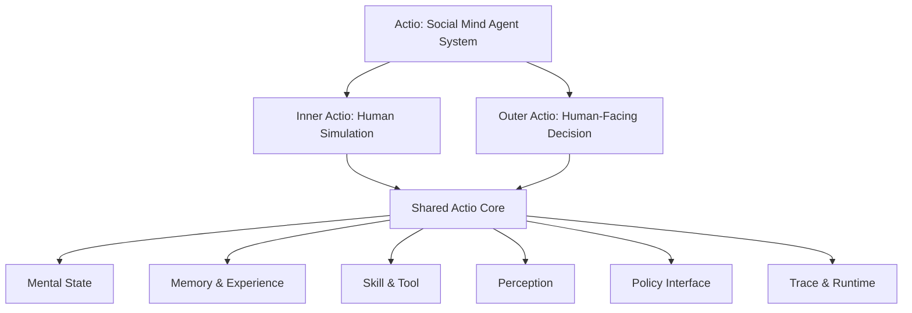
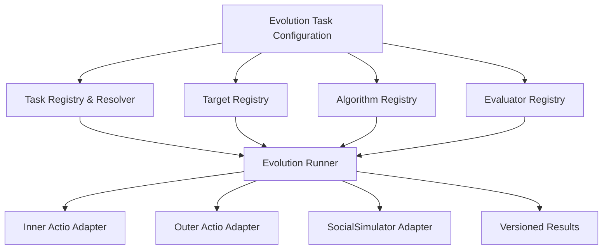
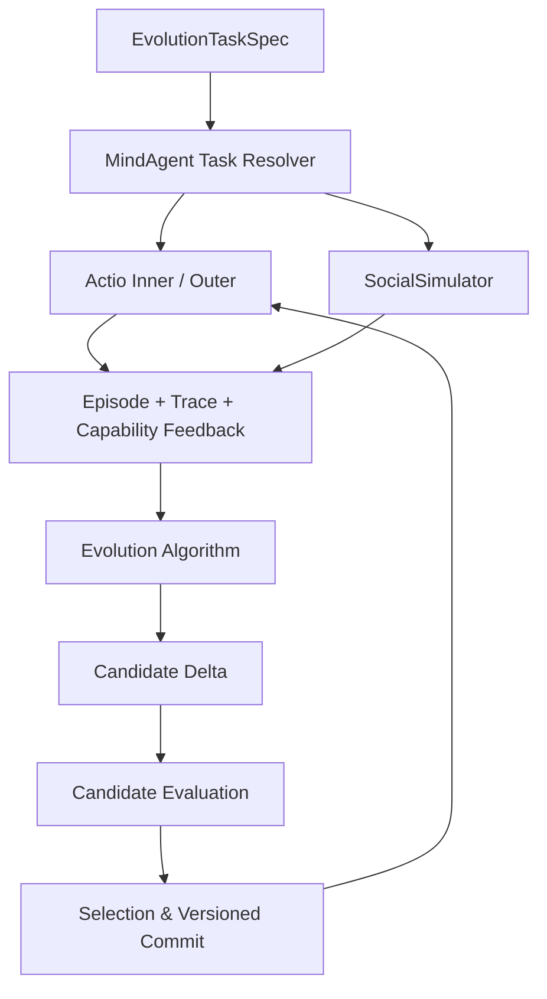

# RISE / Actio / MindAgent 架构改造规划 V3

> **版本**：2026-11-16  
> **性质**：研究与工程改造建议，尚未实施  
> **依据**：上一轮对话形成的 V3 方案；[Rise GitHub 仓库](https://github.com/ChaunceyKung/Rise)；用户上传的《智能体RSI-规划与分工-v2.pptx》  
> **明确排除范围**：RAG、Safety、Norm，不在本轮规划中展开。

## 摘要：三项核心架构决策

建议采用 **Actio 双模式、MindAgent 任务化、演化能力插件化，并让 Actio 与 MindAgent Infra 联合维护可演化的基础组件** 的方案。

1. **Actio**：从单一 SimpleActio Runtime 逐步演进为 `Shared Core + Inner Human Simulation + Outer Human-Facing Decision`。内层模拟人的行为与决策，外层面向人进行分析和决策，两者共享心智状态、记忆、技能、执行及轨迹等基础设施。
2. **MindAgent**：从固定的模型晋级后 Agent Round，演进为 `Evolution Task` 驱动的通用 Agent RSI Engine。能力目标、Actio 模式、演化对象、算法、环境和评价标准可配置。
3. **联合基础设施**：围绕 `Skill & Tool`、`Evolution Efficiency`、`Evolution Algorithms` 建立 Actio–MindAgent 共建工作流。Actio 提供能力表示与执行；MindAgent 提供修改、搜索、验证和版本化提交。

实施原则是 **渐进改造，不推翻已有 RISE 的 ControlPlane、状态机、产物树和端到端闭环**。

---

## 一、系统定位、仓库现状与改造起点

### 1.1 总体边界

| 系统 | 主要职责 | 不负责 |
|---|---|---|
| **Actio** | 社会心智状态、行为生成与决策运行 | 演化搜索和全局演化调度 |
| **MindAgent** | 配置演化任务，选择演化对象与算法，评估与提交改进 | 重复实现 Agent Runtime |
| **SocialSimulator** | 角色、环境状态、交互规则和结果反馈 | 直接管理 Agent 的演化算法 |
| **RecipeStore** | 逐步积累可复用演化配方、历史结果和经验 | 管理 Actio 实时心智状态 |

### 1.2 仓库现状

Rise 当前已具有以下关键基础：

- `src/simple_actio/`：Skill、ReasoningExperience、记忆端口、激活轨迹、`instantiate()` 和 `respond()` 等能力。
- `src/mindagent/`：部署、分析、提案、验证、打包、收录等流水线。
- `src/controlplane/`：Git 版本化产物树、状态机、调和循环、人工审核与失败重入。
- `src/factory/`：组合根，装配运行时、模型服务和各子系统。
- MindAgent 已有真实 vLLM 部署路径（通过 `--agent-backend vllm` 显式启用）；但对应路径加载基础模型，而不是依据 `checkpoint_ref` 自动选择晋级模型权重。

现状缺口：

1. 尚未在 Actio 中显式建模“模拟人的行为与决策”和“面向人的分析与决策”两类模式。
2. 现有 MindAgent 的配置主要围绕 Scenario、角色绑定、轮数及固定阈值，缺少独立的能力优化任务表达。
3. `rounds.py` 将部署、分析、提案、验证串成较固定的流程，算法与任务的可替换性不足。
4. 现有分析偏向固定信号，提案偏向 Skill，尚不能普遍表示不同的演化方向。
5. 新系统必须保留对当前可运行路径的兼容，不能因改造破坏 InteractTrain 或原 AgentRSI。

**策略**：保持原有 `simple_actio` 与 `mindagent` 路径，增设模式包装器、任务协议和插件扩展点；后期再评估是否正式迁移至完整 Actio。

---

## 二、Actio 改造：内层模拟人 + 外层面向人决策

### 2.1 总体设计

Actio 定位为 **共享认知内核、两套决策能力、统一执行接口**。



**Inner / Outer 是研究和运行职责的区分，而非必须分别部署两个完整模型**。一个场景可以只用其中一种模式；也可以由 Outer 调用 Inner 的模拟人物模型辅助分析。

### 2.2 Inner Actio：模拟人的行为与决策

**大目标**：构建具有个体特征、内部心智状态、行为动力和持续交互能力的虚拟人。

| 具象化目标 | 功能模块 | 输入 | 输出 |
|---|---|---|---|
| 个体差异 | Persona & Traits | 人格、偏好、角色、长期特征 | 个体配置 |
| 内部状态 | Mental State | 信念、情绪、目标、记忆 | 持续变化的内部状态 |
| 行为动机 | Motivation & Goals | 需求、当前情境、目标权重 | 行动意图 |
| 模拟决策 | Human Policy | 内部状态、互动历史、环境观察 | 下一步行为选择 |
| 行为生成 | Behavior Realization | 决策意图、语言风格、模型后端 | 语言或环境动作 |
| 状态更新 | State Transition | 行动结果、观察、交互反馈 | 新内部状态与轨迹 |

首批建议支持四种可以组合的行为机制：

- **Goal-driven**：行为受显式目标驱动。
- **Belief-driven**：角色依据自己知道或相信的信息行动。
- **Emotion-modulated**：情绪影响行动选择与表达方式。
- **History-dependent**：过去经历和互动关系影响后续行为。

**示例**：阿瓦隆中的模拟角色可以拥有隐藏身份、对其他玩家的怀疑，以及随投票而改变的信念。Inner Actio 表示这些内部认知与行为机制，SocialSimulator 负责规则、角色分配、事件推进和结果裁决。

**必须维护的信息边界**：模拟器的客观状态不等于人物已知的状态。角色只能接收其可观察的信息，避免隐藏状态泄漏。

### 2.3 Outer Actio：面向人的分析与决策

**大目标**：建模人的心理与任务状态，并利用这种理解优化智能体的分析、交互和决策。

| 具象化目标 | 功能模块 | 输入 | 输出 |
|---|---|---|---|
| 理解交互对象 | Human Modeling | 对话、行为、历史反馈 | 对人当前状态的估计 |
| 分析交互情境 | Interaction Analysis | 人物模型、任务、环境变化 | 情境与机会判断 |
| 目标规划 | Goal & Decision Planning | Agent 目标、用户需求、任务条件 | 决策计划 |
| 策略选择 | Skill / Policy Selection | 目标、心智估计、历史经验 | 行动策略 |
| 工具与行为执行 | Tool & Action Execution | 策略、工具描述、环境上下文 | 回复、工具调用或环境动作 |
| 反馈与适应 | Feedback Update | 结果、人的后续反应 | 模型与策略更新建议 |

**核心区别**：Inner Actio 主要回答“这个人会如何行动”；Outer Actio 主要回答“面对这个人，智能体应当采取什么行动”。

Outer 可以调用 Inner 的人物模型预测对方行为，但最终输出是 AI 自己的决策，而不是简单模仿对方。

### 2.4 Inner / Outer 的评价边界

| 维度 | Inner: Human Simulation | Outer: Human-Facing Decision |
|---|---|---|
| 建模主体 | 被模拟的人 | 与 AI 互动的人 |
| 主要输出 | 人物行为 | AI 的决策和行动 |
| 主要目标 | 行为拟真与状态一致性 | 理解准确性与任务效用 |
| 行为策略 | 模拟目标人物的决策 | 优化 AI 自己的行动 |
| 心智状态 | 模拟人物的内部状态 | 对交互对象的估计（含不确定性） |
| 评价指标 | Behavioral Fidelity、角色一致性、行为预测 | Task Success、Adaptation Gain、Decision Quality |
| 建议上层接口 | `simulate_step()` | `decide_for_human()` |

`simulate_step()` 与 `decide_for_human()` 属于拟新增的上层接口；现有 `respond()` 保留兼容。

### 2.5 Actio 目标目录组织

```text
src/
  simple_actio/
    instance.py           # 现有实例及 respond 兼容入口
    skills.py             # 现有 Skill
    experience.py         # 现有 ReasoningExperience
    memory_port.py        # 现有 MemoryBackend
    trace.py              # 现有轨迹

    core/                 # 拟新增：共享抽象
      state.py            # MindState / AgentState
      observation.py      # PerceivedObservation
      cognition.py        # 认知处理协议
      policy.py           # 行为策略接口
      action.py           # Action / Decision

    inner/                # 拟新增：模拟人模式
      persona_model.py
      motivation.py
      human_policy.py
      simulator_adapter.py

    outer/                # 拟新增：面向人决策模式
      human_model.py
      interaction.py
      decision_policy.py
      action_adapter.py

    adapters/
      legacy.py           # 旧 instantiate / respond 兼容
```

**不要一次性创建全部目录**。P0 先做 `core/state.py`、`core/policy.py`、两类 adapter 和两条最小行为路径。等完整 Actio 接入后，通过替换适配器或具体实现完成迁移，而不破坏 MindAgent 的任务契约。

---

## 三、MindAgent：从固定 Agent Round 改造成可配置 Evolution Task

### 3.1 需要解除的当前耦合

| 当前代码 | 当前作用 | 新需求 |
|---|---|---|
| [`mindagent/config.py`](https://github.com/ChaunceyKung/Rise/blob/main/src/mindagent/config.py) | 情境、角色、轮数和固定阈值配置 | 增加能力目标、可修改对象、算法、环境、评价及预算配置 |
| [`mindagent/rounds.py`](https://github.com/ChaunceyKung/Rise/blob/main/src/mindagent/rounds.py) | 固定模型版本触发并执行 Agent Round | 支持同一模型下多个独立 Evolution Task |
| [`mindagent/analysis.py`](https://github.com/ChaunceyKung/Rise/blob/main/src/mindagent/analysis.py) | 固定信号缺陷分析 | 可配置的反馈分析器 |
| [`mindagent/proposals.py`](https://github.com/ChaunceyKung/Rise/blob/main/src/mindagent/proposals.py) | 主要产生 Skill 提案 | 可配置的候选对象和生成方法 |
| [`mindagent/verify.py`](https://github.com/ChaunceyKung/Rise/blob/main/src/mindagent/verify.py) | 行为/触发回放验证 | 能力级独立评价插件 |

现有 `round_id_for(model_id)` 主要以模型身份确定轮次。新架构需要 `task_id` 及稳定的 `evolution_run_id`，使同一模型可分别运行 ToM、合作决策和教学支持等改进任务。

### 3.2 Evolution Task 必须回答的六个问题

1. **What capability?**：希望提升什么能力？（ToM、策略、沟通、认知引导等）
2. **Which agent and mode?**：优化 Inner Actio 模拟行为，还是 Outer Actio 的决策能力？
3. **What can change?**：允许修改 Skill、Experience、Policy、Tool 等哪些对象？
4. **How to improve?**：选择什么算法、反馈方式和搜索预算？
5. **Where to evaluate?**：训练、验证与独立测试使用哪些任务和环境？
6. **What counts as improvement?**：指标、停止条件、成本与保留能力要求是什么？

### 3.3 配置示例：Inner Actio 的心智推断演化任务

> 概念配置，**当前仓库尚不支持这一完整格式**。

```yaml
# evolution_tasks/tom-sim-v1.yaml
task_id: tom-sim-v1
task_version: 1

agent:
  model_ref: zengen-baseline
  actio_mode: inner
  actio_profile_ref: persona-pool-v1

capability:
  family: mentalizing
  objectives:
    - belief_inference
    - intention_inference

workload:
  environment: social_simulator
  train_suite: hidden-belief-train-v1
  validation_suite: hidden-belief-val-v1
  test_suite: hidden-belief-test-v1

evolution:
  targets:
    - skill
    - reasoning_experience
  algorithm: generate_and_test_v1
  parameters:
    candidates_per_round: 4

feedback:
  analyzer: mental_state_errors_v1

evaluation:
  primary_metric: belief_accuracy
  secondary_metrics:
    - intention_accuracy
    - behavior_consistency

budget:
  max_rounds: 5
  max_candidate_evaluations: 40

stop:
  metric_target: 0.85
  max_no_improve_rounds: 2
```

`metric_target: 0.85` 仅演示字段，不是推荐的统一科研阈值。

### 3.4 配置示例：Outer Actio 的策略交互演化任务

| 配置项 | 示例 |
|---|---|
| `actio_mode` | `outer` |
| `capability.family` | `strategic_interaction` |
| Workload | 合作博弈及不同模拟对手 |
| Evolution Targets | Skill、决策策略配置 |
| Evolution Algorithm | 反馈驱动搜索 |
| Primary Metric | 未见对手上的合作收益 |
| Secondary Metrics | 策略适应速度、计算成本 |

两个任务可使用同一 Evolution Runner，但调用不同 Actio 模式与评价套件。

### 3.5 与 MindTrainer 指令区分

| 数据对象 | 主要用途 |
|---|---|
| `Training Directive` | 指导 MindTrainer 的权重级训练 |
| `Evolution Task` | 指导 MindAgent 的非参数 Agent 改进 |
| `Evolution Run` | 一次任务执行与实验结果 |
| `Candidate Delta` | 对某个 Agent 对象提出的变化 |
| `Verification Result` | 候选在任务上的评价结果 |

不要直接把 Evolution Task 塞进现有训练 `directive.yaml`。建议在 ControlPlane 新增任务及结果产物：

```text
control-plane/
  evolution_tasks/
    tom-sim-v1.yaml
    cooperation-v1.yaml

  evolution_runs/
    tom-sim-v1/
      round-001.yaml
      round-002.yaml

  skill_library/
    ...

  agent_rounds/       # 保留旧路径
    ...
```

**兼容实施顺序**：先实现能显式启动的任务运行器，再接入 ControlPlane 调和循环；保留旧自动 Agent Round，直到新任务路径完成可靠的恢复与回归测试。

---

## 四、MindAgent 内部模块与插件接口

### 4.1 目标架构



### 4.2 建议的最小接口

| 接口 | 关键方法 | 负责方 |
|---|---|---|
| `EvolutionTask` | `validate()`、`resolve()` | MindAgent Infra |
| `EvolutionTarget` | `snapshot()`、`validate_delta()`、`apply_candidate()` | Actio 组件 + Infra |
| `EvolutionAlgorithm` | `propose()`、`update()`、`should_stop()` | MindAgent Infra |
| `FailureAnalyzer` | `analyze(episodes, feedback)` | 能力研究组提供实现 |
| `CapabilityEvaluator` | `evaluate(agent, suite)` | 能力研究组定义指标，Infra 执行 |
| `EvolutionRunner` | `run_task(task_spec)` | MindAgent Infra |
| `ActioRuntimeAdapter` | `make_agent()`、`execute_episode()` | Actio + Infra |

`EvolutionTarget` 的 `apply_candidate()` 应仅在可恢复的测试副本中生效；正式写入仍需通过现有提案、审核、收录流程。

### 4.3 MindAgent 建议目标目录

```text
src/mindagent/
  # 保留
  rounds.py
  deployment.py
  analysis.py
  proposals.py
  verify.py
  packaging.py
  admit.py
  library.py

  # 新增任务定义
  tasks/
    spec.py
    registry.py
    resolver.py

  # 新增演化对象适配
  targets/
    base.py
    skill_target.py
    experience_target.py
    policy_target.py

  # 新增演化算法接口及实现
  algorithms/
    base.py
    registry.py
    rule_baseline.py
    generate_test.py
    iterative_refinement.py

  # 新增统一运行
  engine/
    runner.py
    search_state.py
    budget.py

  # 新增评价接口
  evaluation/
    base.py
    registry.py
    comparison.py
```

首次实施只需让 **`TaskSpec → Runner → Target / Algorithm / Evaluator`** 纵向贯通，其余模块在真实扩展需求出现后逐步拆分。

### 4.4 算法不要绑定能力类型

可注册的基本算法包括：

- Rule Baseline
- Single Candidate
- Generate-and-Test
- Iterative Refinement
- Evolutionary Search

RRSI、Gödel-Machine 等可作为后期接入或复现实验的独立 Adapter，不能仅凭名称即假设其能在所有任务中有效。

每种算法显式声明兼容演化对象、调用预算、反馈依赖与跨轮状态要求。

**四个独立维度**：能力决定目标；演化对象决定能改什么；算法决定如何搜索；评估器判断结果是否改善。

---

## 五、Actio × MindAgent 的联合工作组

采用 **三个主要联合工作组 + 一个公共集成职责**。这些是联合技术工作流，不一定要配置三个额外的专职学生小组。

### 5.1 Joint A：Skill & Tool Evolution

**目标**：打通 Skill/Tool 从表示、执行、修改、验证到收录的生命周期。

| 层次 | Actio 侧 | MindAgent 侧 |
|---|---|---|
| Definition | Skill / Tool 数据结构、能力描述 | 可演化字段的限制与声明 |
| Activation | Skill 路由、Tool 选择与调用 | 技能缺陷发现 |
| Execution | 真实执行、记录结果 | 生成和测试候选 |
| Evolution | 可版本化对象表示 | Mutation、Search、Selection |
| Measurement | 激活与执行轨迹 | 候选与基线能力比较 |
| Lifecycle | 加载指定版本 | 提案、收录、更新、撤回 |

三类对象应区分：

- **Skill**：可复用行为策略；
- **Tool**：可调用的外部操作能力；
- **Harness**：上下文、模型、工具与工作流的执行机制。

**建议修改**：

| 代码位置 | 主要改动 |
|---|---|
| `simple_actio/skills.py` | Skill 元数据、模式适用范围与稳定版本引用 |
| `simple_actio/instance.py` | 可配置的 Skill / Tool 选择策略 |
| `simple_actio/core/` | 行为与工具执行接口 |
| `mindagent/targets/skill_target.py` | Skill Delta 的解析、受控应用和验证 |
| `mindagent/algorithms/` | 以反馈驱动的 Skill/Tool 候选优化 |
| `mindagent/admit.py` | 逐步扩展可收录对象，保持兼容 |

**边界**：初期只修改 Skill 内容、触发条件和工具选择策略，不把工具实现代码或 Harness 整体自修改放入 P0。

**最小 Demo**：在合作任务中比较 `No Skill → Fixed Skill → Evolved Skill`；检查技能激活、目标能力收益与未见交互对象上的表现。

### 5.2 Joint B：Evolution Efficiency

**目标**：用更少的执行和验证成本，获得可比较的能力提升。

拆成两个效率层次：

1. **Actio Runtime Efficiency**：单次 Agent 的推理、上下文预算、Skill/Tool 执行和状态更新成本。
2. **MindAgent Evolution Efficiency**：候选生成、搜索、评价调度与跨轮预算成本。

| 子目标 | 研究问题 | 初期实现 |
|---|---|---|
| E1 Runtime Cost | 单次行动如何更省成本？ | 统一 Token、延迟、模型与工具调用记录 |
| E2 Search Efficiency | 如何减少无效候选？ | Best-of-K、Early Stopping、预算控制 |
| E3 Verification Efficiency | 如何减少冗余评价？ | 分阶段验证、早期淘汰、结果重放 |
| E4 Long-term Evolution Efficiency | 如何降低获得长期能力收益的累计预算？ | 收益—预算曲线、达到目标的成本 |

统一成本数据结构（概念设计）：

```python
EvolutionCost:
    model_calls
    input_tokens
    output_tokens
    tool_calls
    candidate_count
    evaluation_count
    wall_time_ms
    gpu_seconds
```

优先复用仓库现有成本记账与运行轨迹。不知道的成本以缺失表示，不要填写 0。

辅助指标：

\[
\mathrm{Efficiency} = \frac{\mathrm{Validated\ Capability\ Gain}}{\mathrm{Measured\ Evolution\ Cost}}
\]

但不能只报告该比值；还应报告收益、成本及**固定预算下的收益曲线**，避免低成本近零收益造成虚高结论。

### 5.3 Joint C：Evolution Algorithms

**目标**：让不同演化算法复用同一任务、对象与评价流水线。

| 操作 | 输入 | 输出 |
|---|---|---|
| Diagnose | 交互轨迹、反馈 | 改进需求 |
| Propose | 改进需求、对象版本 | 候选增量 |
| Evaluate | 候选、评价套件 | 测试结果 |
| Update Search | 结果、搜索状态 | 下一轮搜索策略 |
| Terminate | 收益、成本、停止条件 | 继续或停止 |

建议接口：

```python
class EvolutionAlgorithm(Protocol):
    def initialize(self, task, agent, budget): ...
    def propose(self, state, feedback): ...
    def update(self, state, evaluations): ...
    def should_stop(self, state) -> bool: ...
```

算法只负责搜索和候选，不直接写正式 Agent 对象；正式提交仍由现有验证和收录流程控制。

### 5.4 公共集成职责

| 接口 | 来源 | 使用方 |
|---|---|---|
| `AgentRuntime` | Actio | MindAgent / SocialSimulator |
| `EvolutionTarget` | Actio 对象适配器 | MindAgent |
| `EpisodeTrace` | Actio + SocialSimulator | 分析与评估模块 |
| `EvolutionResult` | MindAgent | 版本化产物及后续实验 |

**现实依赖**：现有 `factory/agent_backend.py` 的 vLLM 部署虽能运行真实模型，但当前不能依据 `checkpoint_ref` 自动选择被晋级模型。因此正式开展跨模型版本的收益比较前，需要验证“配置的模型版本”和“后端实际加载权重”一致。

---

## 六、系统数据流与通信约束



MindAgent Task Resolver 负责解析能力目标、对象版本、算法、任务和评价协议。Actio 负责行为执行，SocialSimulator 负责环境交互，结果再反馈给演化算法。候选经过比较与收录后进入下一轮。

**通信硬约束**：保持现有 RISE 通过 ControlPlane 的版本化产物交换跨子系统状态；仅沿用已有高频受限实时通信通道，不新增任意直连 RPC。

---

## 七、代码级改动清单

| 优先级 | 修改 | 位置 | 验收 |
|---|---|---|---|
| **P0** | Actio 内外模式与共享状态、策略协议 | `simple_actio/core/`、`inner/`、`outer/` | 同一底座运行两种模式的任务 |
| **P0** | Evolution Task 配置、校验和解析 | `mindagent/tasks/` | 可以表达不同优化方向和对象 |
| **P0** | 独立 Task Runner | `mindagent/engine/runner.py` | 同一模型运行两个独立演化任务 |
| **P0** | 固定分析、提案、验证函数可替换 | `mindagent/rounds.py` 及算法模块 | 不修改流程主体即可切换算法 |
| **P0** | 真实模型版本绑定验证 | `factory/agent_backend.py` 等 | 可记录并核对实际加载的模型权重 |
| **P1** | Target Registry 和 Delta | `mindagent/targets/` | Skill、Experience 可以用统一机制测试 |
| **P1** | Skill/Tool 与 Target Adapter 联合 | `simple_actio/` + `mindagent/targets/` | 可验证对象变化与行为结果 |
| **P1** | 算法插件、预算、成本 | `mindagent/algorithms/`、`engine/budget.py` | 同预算下算法可比较 |
| **P1** | Capability Evaluator Adapter | `mindagent/evaluation/` | 同任务可切换评价套件 |
| **P2** | Workflow / Harness Target | 追加 Target Adapter | 受控候选测试与版本恢复 |
| **P2** | 正式 Actio 接入 | `factory` 组合根、适配器 | 替换后端不破坏任务及算法契约 |
| **P2** | Task 调度接入 ControlPlane | `controlplane/`、`factory/handlers.py` | 触发、失败恢复与幂等正确 |

每一类新增接口都必须有独立契约测试和向后兼容测试。

---

## 八、三个实施阶段

### Phase 1（第 1–3 周）：架构定型与两个最小 Demo

- 明确 Inner / Outer Actio 的职责、基础状态对象和接口。
- 完成 `EvolutionTaskSpec`、Task 解析和一个最简算法路径。
- 使用固定环境分别运行模拟人、面向人决策两种 Demo。
- 完成真实后端的模型身份记录核对。

**交付**：一个 Inner Demo、一个 Outer Demo、两个不同配置的 RSI Task。

### Phase 2（第 4–7 周）：可演化对象与算法插件

- 打通 Skill 和 ReasoningExperience 的 Target Adapter。
- 支持至少两种候选生成或搜索方法。
- 统一能力评价与运行成本记录。
- 对相同模型/任务开展固定预算下的对照。

**交付**：两类对象、至少两种算法、一套可复现的同预算对照实验。

### Phase 3（第 8–12 周）：真实环境与多轮演化

- 接入多个 SocialSimulator 通用交互任务。
- 执行连续多轮 RSI，分析性能与成本曲线。
- 完善模型版本绑定、演化结果追踪和不同任务间的隔离。
- 视实际需求扩大 Target 与 Algorithm 目录。

**交付**：研究人员能以一份 Evolution Task 配置运行、比较和复现 Agent RSI 的实验系统。

上述周次是建议排期，不是已完成的工程进度。继续保留无 GPU 的确定性测试路径。

---

## 九、团队人员与职责分配

按 Actio 3 人、MindAgent 4–5 人配置：

| 角色 | 主责 | 主要模块 | 对接对象 |
|---|---|---|---|
| **Actio-A（主力）** | Shared Core、统一 Runtime、Skill/Tool 执行 | Core、Runtime、Skill/Tool | MA-Infra |
| Actio-B | Inner Actio | Persona、Mental State、Human Policy | SocialSimulator |
| Actio-C | Outer Actio | Human Modeling、Decision Policy、Action | MindAgent 能力组 |
| **MA-Infra（主力）** | Task、Runner、Target/Algorithm Registry、集成 | Tasks、Engine、Registries | 全体 |
| MA-B | 社会感知、心智推断与适应 | 能力任务、对应 RSI 方法 | Actio-B/C |
| MA-C | 社会博弈与策略推理 | 能力任务、对应 RSI 方法 | Actio / Infra |
| MA-D | 社会沟通与认知引导中优先启动的一条 | 能力任务、对应 RSI 方法 | Actio / Infra |
| MA-E（可选） | 另一条能力方向 | 能力任务、对应 RSI 方法 | Actio / Infra |

联合工作流无需增加专职编制：

- **Skill & Tool**：Actio-A 与 MA-Infra 联合负责。
- **Evolution Efficiency**：MA-Infra 维护测量和预算设施，各能力研究组贡献算法。
- **Evolution Algorithms**：MA-Infra 维护插件契约，能力研究组提出和实现新方法。
- **Inner / Outer Actio**：分别由 Actio-B、Actio-C 主责，复用 Actio-A 的共享核心。

---

## 十、必须锁定的工程原则与兼容细节

| 原则 | 要求 |
|---|---|
| 一套核心、两种 Actio 模式 | 不复制两套 Skill、Memory、Trace 与模型后端 |
| Task 优先 | 先明确目标和验证，再选择可修改对象和算法 |
| 对象 / 算法 / 评价解耦 | Skill 内不内嵌搜索，算法内不硬编码某类任务 |
| 保留既有控制语义 | 延续 GitStore、状态机、审核、故障重入和产物契约 |
| 先纵向再横向 | 内外各一条任务跑通后再扩展能力和算法 |

需要重点检查三个兼容风险：

1. **`respond()` 三元组兼容**：当前 SimpleActio 与 SocialSimulator 的 `(utterance, inner_thought, trace)` 不应被新 Decision 类型直接替换，可通过 adapter 映射。
2. **`simple_actio.trace.v2` 类型约束**：数值能力和成本指标放在独立的 Evaluation / Cost 产物中，不破坏旧激活轨迹格式。
3. **任务并行与可恢复**：新任务用 `task_id + round` 识别；共享模型服务和对象库要有隔离和冲突处理；候选在独立副本上评估，正式提交保持串行协调。

---

## 十一、优先实施的两个验证 Demo

### Demo A：Inner Actio × 社会模拟

**场景**：两名拥有不同信念、目标和人格的模拟角色进行信息不对称交互。

**演化任务**：改善人物行为一致性或心智推断机制。

**验证要求**：

- 角色只能使用可观察信息；
- 不同 Persona 的行为具有可观测差异；
- 心智状态随交互更新；
- 新配置与基线的行为变化可测量；
- 可完成一次提案、验证和演化提交。

### Demo B：Outer Actio × 面向人的决策

**场景**：Agent 在合作任务中需要理解对方目标、反馈和行动，然后选择适合的 Skill 或策略。

**演化任务**：改善适应性决策和合作效果。

**验证要求**：

- Outer Actio 能估计交互对象状态；
- 能以目标和状态驱动策略选择；
- 比较固定策略与演化策略的任务表现；
- 测量适应速度与演化成本；
- 具备独立的保留任务验证。

两项 Demo 可以复用一套情境定义：Inner Actio 生成被模拟者行为，Outer Actio 根据可观察交互作出面向人的决策。由此为日后研究“用模拟人物训练面向人的智能体”保留自然接口。

---

## 十二、最终建议：最优先落地的四项改动

1. **`ActioMode + Shared Core`**：先定义状态、策略接口和 Inner / Outer 两类 adapter。
2. **`EvolutionTaskSpec + Task Runner`**：使同一模型能够独立执行不同能力方向的 RSI 实验。
3. **`SkillTarget + EvolutionAlgorithm`**：打通最小演化插件通道，明确可修改对象与算法接口。
4. **双模式端到端验证**：各选择一个可运行任务，对比改进前后能力与成本，确保演化收益不是只来自路由变化。

四项完成后再决定是否需要大规模重构。核心是将 **Actio 的认知与执行、MindAgent 的演化任务与搜索、SocialSimulator 的交互环境** 分开，并通过稳定接口实现可组合的能力研究与联合开发。

---

## 参考材料与代码入口

- [Rise 项目仓库](https://github.com/ChaunceyKung/Rise)
- [SimpleActio 设计文档](https://github.com/ChaunceyKung/Rise/blob/main/docs/design/40-simple-actio.md)
- [MindAgent 设计文档](https://github.com/ChaunceyKung/Rise/blob/main/docs/design/50-mindagent.md)
- [系统总览](https://github.com/ChaunceyKung/Rise/blob/main/docs/design/00-overview.md)
- [SimpleActio `instance.py`](https://github.com/ChaunceyKung/Rise/blob/main/src/simple_actio/instance.py)
- [MindAgent `config.py`](https://github.com/ChaunceyKung/Rise/blob/main/src/mindagent/config.py)
- [MindAgent `rounds.py`](https://github.com/ChaunceyKung/Rise/blob/main/src/mindagent/rounds.py)
- [MindAgent `analysis.py`](https://github.com/ChaunceyKung/Rise/blob/main/src/mindagent/analysis.py)
- [MindAgent `proposals.py`](https://github.com/ChaunceyKung/Rise/blob/main/src/mindagent/proposals.py)
- [MindAgent `verify.py`](https://github.com/ChaunceyKung/Rise/blob/main/src/mindagent/verify.py)
- [Factory `agent_backend.py`](https://github.com/ChaunceyKung/Rise/blob/main/src/factory/agent_backend.py)
- 本次依据的演示文稿：`智能体RSI-规划与分工-v2.pptx`（用户上传）。

> 注：本文中的新增目录、类、方法、配置和时间节点均属于**规划建议**；不能据此推断其已在 GitHub 主分支落地。
